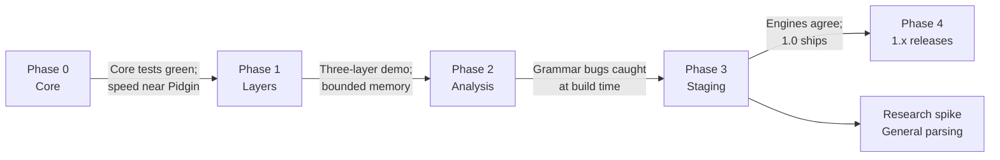

# Creole work items

This folder breaks the [Creole whitepaper](../whitepaper.md) into epics and work items.

- Each epic is a folder under [`active/`](active/), and each work item is a Markdown file inside it.
- Every work item lists what blocks it and what it unblocks. Blockers are hard dependencies: an item should not start until its blockers are done.
- Phases follow the whitepaper's [Roadmap](../whitepaper.md#roadmap). An item can start as soon as its blockers are done, even if earlier phases still have unrelated work open.

**Sizes** are rough relative estimates: S is days, M is one to two weeks, L is two to four weeks, XL is more than a month.

**Totals:** 18 epics, 116 work items.

## Roadmap

Within each phase, work is grouped into **waves**. A wave's items depend only on items in earlier waves (of this or an earlier phase), so everything in one wave can run in parallel.

Note: [FND-07](active/01-foundations/FND-07-validate-c-15-features-and-decide-parseresult-t.md) waits on the .NET 11 / C# 15 GA compiler (expected November 2026), and the error and result types (ERR-01) wait on its decision. Work that does not touch the public result types can proceed before then.

### Phase 0 — Core

**Scope:** Combinator set, interpreter, error model.  
**Gate:** Core tests green; speed near Pidgin.

| Wave | Work item | Size | Blocked by |
| --- | --- | --- | --- |
| 1 | [FND-01](active/01-foundations/FND-01-reserve-the-creole-nuget-package-id.md) Reserve the Creole NuGet package ID | S | — |
| 1 | [FND-02](active/01-foundations/FND-02-repository-and-solution-scaffolding.md) Repository and solution scaffolding | S | — |
| 1 | [FND-08](active/01-foundations/FND-08-whitepaper-editorial-cleanup.md) Whitepaper editorial cleanup | S | — |
| 2 | [FND-03](active/01-foundations/FND-03-continuous-integration.md) Continuous integration | S | [FND-02](active/01-foundations/FND-02-repository-and-solution-scaffolding.md) |
| 2 | [FND-04](active/01-foundations/FND-04-test-infrastructure.md) Test infrastructure | S | [FND-02](active/01-foundations/FND-02-repository-and-solution-scaffolding.md) |
| 2 | [FND-05](active/01-foundations/FND-05-benchmark-harness.md) Benchmark harness | M | [FND-02](active/01-foundations/FND-02-repository-and-solution-scaffolding.md) |
| 2 | [FND-07](active/01-foundations/FND-07-validate-c-15-features-and-decide-parseresult-t.md) Validate C# 15 features and decide `ParseResult<T>` | S | [FND-02](active/01-foundations/FND-02-repository-and-solution-scaffolding.md); .NET 11 / C# 15 GA (expected November 2026) |
| 2 | [CORE-01](active/02-core-combinators/CORE-01-grammar-node-model.md) Grammar node model | M | [FND-02](active/01-foundations/FND-02-repository-and-solution-scaffolding.md) |
| 2 | [INT-01](active/03-interpreter/INT-01-cursor-and-in-memory-input.md) Cursor and in-memory input | M | [FND-02](active/01-foundations/FND-02-repository-and-solution-scaffolding.md) |
| 2 | [SPAN-01](active/05-source-spans/SPAN-01-sourcespan-sourceid-and-linemap.md) SourceSpan, SourceId and LineMap | S | [FND-02](active/01-foundations/FND-02-repository-and-solution-scaffolding.md) |
| 3 | [FND-06](active/01-foundations/FND-06-fix-numeric-gate-thresholds.md) Fix numeric gate thresholds | S | [FND-05](active/01-foundations/FND-05-benchmark-harness.md) |
| 3 | [CORE-02](active/02-core-combinators/CORE-02-grammar-base-classes-and-authoring-surface.md) Grammar base classes and authoring surface | M | [CORE-01](active/02-core-combinators/CORE-01-grammar-node-model.md) |
| 3 | [CORE-04](active/02-core-combinators/CORE-04-sequencing-and-mapping-nodes.md) Sequencing and mapping nodes | M | [CORE-01](active/02-core-combinators/CORE-01-grammar-node-model.md) |
| 3 | [CORE-05](active/02-core-combinators/CORE-05-choice-nodes.md) Choice nodes | M | [CORE-01](active/02-core-combinators/CORE-01-grammar-node-model.md) |
| 3 | [CORE-06](active/02-core-combinators/CORE-06-longest.md) Longest | S | [CORE-01](active/02-core-combinators/CORE-01-grammar-node-model.md) |
| 3 | [CORE-07](active/02-core-combinators/CORE-07-repetition-nodes.md) Repetition nodes | M | [CORE-01](active/02-core-combinators/CORE-01-grammar-node-model.md) |
| 3 | [CORE-08](active/02-core-combinators/CORE-08-control-nodes.md) Control nodes | M | [CORE-01](active/02-core-combinators/CORE-01-grammar-node-model.md) |
| 3 | [CORE-09](active/02-core-combinators/CORE-09-recursion-with-rec.md) Recursion with Rec | S | [CORE-01](active/02-core-combinators/CORE-01-grammar-node-model.md) |
| 3 | [CORE-11](active/02-core-combinators/CORE-11-expressionbuild.md) Expression.Build | M | [CORE-01](active/02-core-combinators/CORE-01-grammar-node-model.md) |
| 3 | [CORE-12](active/02-core-combinators/CORE-12-custom-primitives.md) Custom primitives | S | [CORE-01](active/02-core-combinators/CORE-01-grammar-node-model.md) |
| 3 | [INT-02](active/03-interpreter/INT-02-plan-lowering-and-cache.md) Plan lowering and cache | M | [CORE-01](active/02-core-combinators/CORE-01-grammar-node-model.md), [INT-01](active/03-interpreter/INT-01-cursor-and-in-memory-input.md) |
| 3 | [ERR-01](active/04-errors-and-recovery/ERR-01-error-and-result-types.md) Error and result types | M | [FND-07](active/01-foundations/FND-07-validate-c-15-features-and-decide-parseresult-t.md), [SPAN-01](active/05-source-spans/SPAN-01-sourcespan-sourceid-and-linemap.md) |
| 4 | [CORE-03](active/02-core-combinators/CORE-03-primitive-nodes.md) Primitive nodes | M | [CORE-02](active/02-core-combinators/CORE-02-grammar-base-classes-and-authoring-surface.md) |
| 4 | [CORE-10](active/02-core-combinators/CORE-10-bind-and-linq-query-syntax.md) Bind and LINQ query syntax | L | [CORE-04](active/02-core-combinators/CORE-04-sequencing-and-mapping-nodes.md) |
| 4 | [ERR-03](active/04-errors-and-recovery/ERR-03-diagnostic-rendering.md) Diagnostic rendering | M | [ERR-01](active/04-errors-and-recovery/ERR-01-error-and-result-types.md), [SPAN-01](active/05-source-spans/SPAN-01-sourcespan-sourceid-and-linemap.md) |
| 5 | [INT-03](active/03-interpreter/INT-03-execute-the-core-combinators.md) Execute the core combinators | L | [CORE-03](active/02-core-combinators/CORE-03-primitive-nodes.md), [CORE-04](active/02-core-combinators/CORE-04-sequencing-and-mapping-nodes.md), [CORE-05](active/02-core-combinators/CORE-05-choice-nodes.md), [CORE-06](active/02-core-combinators/CORE-06-longest.md), [CORE-07](active/02-core-combinators/CORE-07-repetition-nodes.md), [CORE-08](active/02-core-combinators/CORE-08-control-nodes.md), [CORE-09](active/02-core-combinators/CORE-09-recursion-with-rec.md), [INT-02](active/03-interpreter/INT-02-plan-lowering-and-cache.md) |
| 6 | [INT-04](active/03-interpreter/INT-04-execute-bind-expressionbuild-and-custom.md) Execute Bind, Expression.Build and Custom | M | [CORE-10](active/02-core-combinators/CORE-10-bind-and-linq-query-syntax.md), [CORE-11](active/02-core-combinators/CORE-11-expressionbuild.md), [CORE-12](active/02-core-combinators/CORE-12-custom-primitives.md), [INT-03](active/03-interpreter/INT-03-execute-the-core-combinators.md) |
| 6 | [INT-05](active/03-interpreter/INT-05-interpreter-lowering-rewrites.md) Interpreter lowering rewrites | M | [INT-03](active/03-interpreter/INT-03-execute-the-core-combinators.md) |
| 6 | [INT-06](active/03-interpreter/INT-06-dfa-compiler-for-regular-subtrees.md) DFA compiler for regular subtrees | L | [INT-03](active/03-interpreter/INT-03-execute-the-core-combinators.md) |
| 6 | [INT-07](active/03-interpreter/INT-07-recursion-depth-limit.md) Recursion depth limit | S | [INT-03](active/03-interpreter/INT-03-execute-the-core-combinators.md), [ERR-01](active/04-errors-and-recovery/ERR-01-error-and-result-types.md) |
| 6 | [ERR-02](active/04-errors-and-recovery/ERR-02-furthest-failure-tracking-and-labels.md) Furthest-failure tracking and labels | L | [INT-03](active/03-interpreter/INT-03-execute-the-core-combinators.md), [ERR-01](active/04-errors-and-recovery/ERR-01-error-and-result-types.md) |
| 7 | [INT-08](active/03-interpreter/INT-08-single-layer-parse-api.md) Single-layer Parse API | S | [INT-03](active/03-interpreter/INT-03-execute-the-core-combinators.md), [ERR-02](active/04-errors-and-recovery/ERR-02-furthest-failure-tracking-and-labels.md) |
| 8 | [BENCH-01](active/13-benchmarks/BENCH-01-phase-0-speed-gate.md) Phase 0 speed gate **(Phase 0 gate)** | S | [FND-06](active/01-foundations/FND-06-fix-numeric-gate-thresholds.md), [INT-05](active/03-interpreter/INT-05-interpreter-lowering-rewrites.md), [INT-06](active/03-interpreter/INT-06-dfa-compiler-for-regular-subtrees.md), [INT-08](active/03-interpreter/INT-08-single-layer-parse-api.md), [ERR-02](active/04-errors-and-recovery/ERR-02-furthest-failure-tracking-and-labels.md) |

### Phase 1 — Layers

**Scope:** Pipelines, buffers and spans, mode channels, streaming.  
**Gate:** Three-layer demo runs; memory stays bounded.

| Wave | Work item | Size | Blocked by |
| --- | --- | --- | --- |
| 1 | [LAY-01](active/06-layers-and-pipelines/LAY-01-streambuffer-and-pulling-cursor.md) StreamBuffer and pulling cursor | L | [INT-01](active/03-interpreter/INT-01-cursor-and-in-memory-input.md) |
| 2 | [SPAN-02](active/05-source-spans/SPAN-02-out-of-band-span-storage.md) Out-of-band span storage | M | [SPAN-01](active/05-source-spans/SPAN-01-sourcespan-sourceid-and-linemap.md), [LAY-01](active/06-layers-and-pipelines/LAY-01-streambuffer-and-pulling-cursor.md) |
| 3 | [SPAN-04](active/05-source-spans/SPAN-04-span-combinators.md) Span combinators | S | [SPAN-02](active/05-source-spans/SPAN-02-out-of-band-span-storage.md) |
| 4 | [LAY-02](active/06-layers-and-pipelines/LAY-02-marks-and-retention.md) Marks and retention | L | [INT-03](active/03-interpreter/INT-03-execute-the-core-combinators.md), [LAY-01](active/06-layers-and-pipelines/LAY-01-streambuffer-and-pulling-cursor.md) |
| 4 | [LAY-03](active/06-layers-and-pipelines/LAY-03-layer-abstraction-and-emit.md) Layer abstraction and Emit | L | [INT-03](active/03-interpreter/INT-03-execute-the-core-combinators.md), [LAY-01](active/06-layers-and-pipelines/LAY-01-streambuffer-and-pulling-cursor.md) |
| 5 | [ERR-04](active/04-errors-and-recovery/ERR-04-diagnostic-withdrawal.md) Diagnostic withdrawal | M | [ERR-01](active/04-errors-and-recovery/ERR-01-error-and-result-types.md), [LAY-02](active/06-layers-and-pipelines/LAY-02-marks-and-retention.md) |
| 5 | [SPAN-03](active/05-source-spans/SPAN-03-synthetic-items.md) Synthetic items | S | [SPAN-02](active/05-source-spans/SPAN-02-out-of-band-span-storage.md), [LAY-03](active/06-layers-and-pipelines/LAY-03-layer-abstraction-and-emit.md) |
| 5 | [SPAN-05](active/05-source-spans/SPAN-05-trivia-attach-mode.md) Trivia attach mode | M | [SPAN-02](active/05-source-spans/SPAN-02-out-of-band-span-storage.md), [LAY-03](active/06-layers-and-pipelines/LAY-03-layer-abstraction-and-emit.md) |
| 5 | [SPAN-06](active/05-source-spans/SPAN-06-byte-sources-and-the-decoding-layer.md) Byte sources and the decoding layer | M | [SPAN-02](active/05-source-spans/SPAN-02-out-of-band-span-storage.md), [LAY-03](active/06-layers-and-pipelines/LAY-03-layer-abstraction-and-emit.md) |
| 5 | [LAY-04](active/06-layers-and-pipelines/LAY-04-layer-local-state.md) Layer-local state | M | [LAY-02](active/06-layers-and-pipelines/LAY-02-marks-and-retention.md), [LAY-03](active/06-layers-and-pipelines/LAY-03-layer-abstraction-and-emit.md) |
| 5 | [LAY-05](active/06-layers-and-pipelines/LAY-05-pipeline-api-and-sources.md) Pipeline API and sources | M | [ERR-01](active/04-errors-and-recovery/ERR-01-error-and-result-types.md), [LAY-03](active/06-layers-and-pipelines/LAY-03-layer-abstraction-and-emit.md) |
| 5 | [LAY-06](active/06-layers-and-pipelines/LAY-06-buffer-size-limit.md) Buffer size limit | S | [ERR-02](active/04-errors-and-recovery/ERR-02-furthest-failure-tracking-and-labels.md), [LAY-02](active/06-layers-and-pipelines/LAY-02-marks-and-retention.md) |
| 5 | [MODE-01](active/07-mode-channels/MODE-01-mode-channels-and-layermodal.md) Mode channels and Layer.Modal | M | [LAY-03](active/06-layers-and-pipelines/LAY-03-layer-abstraction-and-emit.md) |
| 5 | [STRM-01](active/08-streaming/STRM-01-starved-outcome.md) Starved outcome | M | [LAY-02](active/06-layers-and-pipelines/LAY-02-marks-and-retention.md) |
| 6 | [LAY-07](active/06-layers-and-pipelines/LAY-07-three-layer-demo-and-bounded-memory-check.md) Three-layer demo and bounded-memory check **(Phase 1 gate)** | M | [SPAN-03](active/05-source-spans/SPAN-03-synthetic-items.md), [LAY-04](active/06-layers-and-pipelines/LAY-04-layer-local-state.md), [LAY-05](active/06-layers-and-pipelines/LAY-05-pipeline-api-and-sources.md), [LAY-06](active/06-layers-and-pipelines/LAY-06-buffer-size-limit.md) |
| 6 | [MODE-02](active/07-mode-channels/MODE-02-invalidation-rule.md) Invalidation rule | L | [ERR-04](active/04-errors-and-recovery/ERR-04-diagnostic-withdrawal.md), [LAY-02](active/06-layers-and-pipelines/LAY-02-marks-and-retention.md), [MODE-01](active/07-mode-channels/MODE-01-mode-channels-and-layermodal.md) |
| 6 | [MODE-05](active/07-mode-channels/MODE-05-mode-payloads.md) Mode payloads | S | [MODE-01](active/07-mode-channels/MODE-01-mode-channels-and-layermodal.md) |
| 6 | [STRM-02](active/08-streaming/STRM-02-restart-protocol-and-parsemanyasync.md) Restart protocol and ParseManyAsync | L | [SPAN-06](active/05-source-spans/SPAN-06-byte-sources-and-the-decoding-layer.md), [LAY-05](active/06-layers-and-pipelines/LAY-05-pipeline-api-and-sources.md), [STRM-01](active/08-streaming/STRM-01-starved-outcome.md) |
| 6 | [STRM-04](active/08-streaming/STRM-04-huge-single-documents.md) Huge single documents | S | [LAY-05](active/06-layers-and-pipelines/LAY-05-pipeline-api-and-sources.md) |
| 7 | [MODE-03](active/07-mode-channels/MODE-03-rollback-rule.md) Rollback rule | M | [MODE-02](active/07-mode-channels/MODE-02-invalidation-rule.md) |
| 7 | [MODE-04](active/07-mode-channels/MODE-04-multi-layer-invalidation-cascade.md) Multi-layer invalidation cascade | M | [MODE-02](active/07-mode-channels/MODE-02-invalidation-rule.md) |
| 7 | [STRM-03](active/08-streaming/STRM-03-streaming-diagnostics.md) Streaming diagnostics | M | [ERR-03](active/04-errors-and-recovery/ERR-03-diagnostic-rendering.md), [STRM-02](active/08-streaming/STRM-02-restart-protocol-and-parsemanyasync.md) |
| 8 | [MODE-06](active/07-mode-channels/MODE-06-model-based-tests-for-mode-rollback.md) Model-based tests for mode rollback | M | [FND-04](active/01-foundations/FND-04-test-infrastructure.md), [MODE-03](active/07-mode-channels/MODE-03-rollback-rule.md), [MODE-04](active/07-mode-channels/MODE-04-multi-layer-invalidation-cascade.md) |

### Phase 2 — Analysis

**Scope:** Analyzers, deterministic mode, recovery, grammar-author tooling.  
**Gate:** Classic grammar bugs caught at build time.

| Wave | Work item | Size | Blocked by |
| --- | --- | --- | --- |
| 1 | [RSLN-04](active/10-roslyn-analyzers/RSLN-04-crl0004-forward-field-reference-analyzer.md) CRL0004 forward field reference analyzer | S | [FND-02](active/01-foundations/FND-02-repository-and-solution-scaffolding.md), [CORE-09](active/02-core-combinators/CORE-09-recursion-with-rec.md) |
| 2 | [TOOL-05](active/12-grammar-author-tooling/TOOL-05-ebnf-and-railroad-diagram-export.md) EBNF and railroad diagram export | M | [CORE-03](active/02-core-combinators/CORE-03-primitive-nodes.md), [CORE-04](active/02-core-combinators/CORE-04-sequencing-and-mapping-nodes.md), [CORE-05](active/02-core-combinators/CORE-05-choice-nodes.md), [CORE-07](active/02-core-combinators/CORE-07-repetition-nodes.md), [CORE-08](active/02-core-combinators/CORE-08-control-nodes.md), [CORE-11](active/02-core-combinators/CORE-11-expressionbuild.md) |
| 3 | [ANA-01](active/09-static-analysis/ANA-01-grammar-property-analysis.md) Grammar property analysis | L | [CORE-03](active/02-core-combinators/CORE-03-primitive-nodes.md), [CORE-04](active/02-core-combinators/CORE-04-sequencing-and-mapping-nodes.md), [CORE-05](active/02-core-combinators/CORE-05-choice-nodes.md), [CORE-06](active/02-core-combinators/CORE-06-longest.md), [CORE-07](active/02-core-combinators/CORE-07-repetition-nodes.md), [CORE-08](active/02-core-combinators/CORE-08-control-nodes.md), [CORE-09](active/02-core-combinators/CORE-09-recursion-with-rec.md), [CORE-10](active/02-core-combinators/CORE-10-bind-and-linq-query-syntax.md), [CORE-11](active/02-core-combinators/CORE-11-expressionbuild.md), [CORE-12](active/02-core-combinators/CORE-12-custom-primitives.md), [LAY-03](active/06-layers-and-pipelines/LAY-03-layer-abstraction-and-emit.md) |
| 4 | [ERR-06](active/04-errors-and-recovery/ERR-06-orinsert-for-missing-items.md) OrInsert for missing items | M | [ERR-02](active/04-errors-and-recovery/ERR-02-furthest-failure-tracking-and-labels.md), [SPAN-03](active/05-source-spans/SPAN-03-synthetic-items.md) |
| 4 | [SPAN-07](active/05-source-spans/SPAN-07-embedded-languages.md) Embedded languages | L | [SPAN-02](active/05-source-spans/SPAN-02-out-of-band-span-storage.md), [LAY-05](active/06-layers-and-pipelines/LAY-05-pipeline-api-and-sources.md) |
| 4 | [ANA-02](active/09-static-analysis/ANA-02-analysis-report-and-debug-enforcement.md) Analysis report and Debug enforcement | M | [ANA-01](active/09-static-analysis/ANA-01-grammar-property-analysis.md) |
| 4 | [RSLN-01](active/10-roslyn-analyzers/RSLN-01-roslyn-grammar-reader.md) Roslyn grammar reader | XL | [FND-02](active/01-foundations/FND-02-repository-and-solution-scaffolding.md), [CORE-02](active/02-core-combinators/CORE-02-grammar-base-classes-and-authoring-surface.md), [CORE-10](active/02-core-combinators/CORE-10-bind-and-linq-query-syntax.md), [CORE-11](active/02-core-combinators/CORE-11-expressionbuild.md), [CORE-12](active/02-core-combinators/CORE-12-custom-primitives.md), [LAY-03](active/06-layers-and-pipelines/LAY-03-layer-abstraction-and-emit.md), [MODE-01](active/07-mode-channels/MODE-01-mode-channels-and-layermodal.md) |
| 4 | [TOOL-01](active/12-grammar-author-tooling/TOOL-01-creoletesting-assertions.md) Creole.Testing assertions | M | [FND-04](active/01-foundations/FND-04-test-infrastructure.md), [ERR-03](active/04-errors-and-recovery/ERR-03-diagnostic-rendering.md), [LAY-05](active/06-layers-and-pipelines/LAY-05-pipeline-api-and-sources.md) |
| 4 | [TOOL-02](active/12-grammar-author-tooling/TOOL-02-tracing.md) Tracing | M | [INT-03](active/03-interpreter/INT-03-execute-the-core-combinators.md), [LAY-05](active/06-layers-and-pipelines/LAY-05-pipeline-api-and-sources.md) |
| 4 | [TOOL-04](active/12-grammar-author-tooling/TOOL-04-grammar-fuzzing.md) Grammar fuzzing | M | [ANA-01](active/09-static-analysis/ANA-01-grammar-property-analysis.md) |
| 5 | [ERR-05](active/04-errors-and-recovery/ERR-05-recover-combinator-and-strategies.md) Recover combinator and strategies | L | [ERR-02](active/04-errors-and-recovery/ERR-02-furthest-failure-tracking-and-labels.md), [ERR-04](active/04-errors-and-recovery/ERR-04-diagnostic-withdrawal.md), [LAY-04](active/06-layers-and-pipelines/LAY-04-layer-local-state.md), [MODE-02](active/07-mode-channels/MODE-02-invalidation-rule.md), [STRM-01](active/08-streaming/STRM-01-starved-outcome.md) |
| 5 | [ANA-03](active/09-static-analysis/ANA-03-loop-and-recursion-checks.md) Loop and recursion checks | M | [LAY-03](active/06-layers-and-pipelines/LAY-03-layer-abstraction-and-emit.md), [ANA-02](active/09-static-analysis/ANA-02-analysis-report-and-debug-enforcement.md) |
| 5 | [ANA-04](active/09-static-analysis/ANA-04-choice-checks.md) Choice checks | L | [INT-06](active/03-interpreter/INT-06-dfa-compiler-for-regular-subtrees.md), [ANA-02](active/09-static-analysis/ANA-02-analysis-report-and-debug-enforcement.md) |
| 5 | [ANA-05](active/09-static-analysis/ANA-05-informational-and-hygiene-checks.md) Informational and hygiene checks | M | [ANA-02](active/09-static-analysis/ANA-02-analysis-report-and-debug-enforcement.md) |
| 5 | [ANA-06](active/09-static-analysis/ANA-06-deterministic-mode.md) Deterministic mode | L | [INT-05](active/03-interpreter/INT-05-interpreter-lowering-rewrites.md), [LAY-02](active/06-layers-and-pipelines/LAY-02-marks-and-retention.md), [MODE-01](active/07-mode-channels/MODE-01-mode-channels-and-layermodal.md), [ANA-01](active/09-static-analysis/ANA-01-grammar-property-analysis.md), [ANA-02](active/09-static-analysis/ANA-02-analysis-report-and-debug-enforcement.md) |
| 5 | [ANA-07](active/09-static-analysis/ANA-07-linear-maximal-munch.md) Linear maximal munch | M | [INT-06](active/03-interpreter/INT-06-dfa-compiler-for-regular-subtrees.md), [ANA-02](active/09-static-analysis/ANA-02-analysis-report-and-debug-enforcement.md) |
| 5 | [ANA-08](active/09-static-analysis/ANA-08-custom-scanner-contract-checks.md) Custom scanner contract checks | S | [INT-04](active/03-interpreter/INT-04-execute-bind-expressionbuild-and-custom.md), [ANA-02](active/09-static-analysis/ANA-02-analysis-report-and-debug-enforcement.md) |
| 5 | [RSLN-02](active/10-roslyn-analyzers/RSLN-02-share-the-analysis-engine-with-the-roslyn-component.md) Share the analysis engine with the Roslyn component | M | [ANA-01](active/09-static-analysis/ANA-01-grammar-property-analysis.md), [RSLN-01](active/10-roslyn-analyzers/RSLN-01-roslyn-grammar-reader.md) |
| 5 | [RSLN-05](active/10-roslyn-analyzers/RSLN-05-grammar-class-hygiene-analyzers.md) Grammar class hygiene analyzers | S | [RSLN-01](active/10-roslyn-analyzers/RSLN-01-roslyn-grammar-reader.md) |
| 5 | [TOOL-03](active/12-grammar-author-tooling/TOOL-03-explain.md) Explain | S | [ERR-02](active/04-errors-and-recovery/ERR-02-furthest-failure-tracking-and-labels.md), [TOOL-02](active/12-grammar-author-tooling/TOOL-02-tracing.md) |
| 6 | [ERR-07](active/04-errors-and-recovery/ERR-07-lexer-recovery-and-cascade-suppression.md) Lexer recovery and cascade suppression | M | [ERR-05](active/04-errors-and-recovery/ERR-05-recover-combinator-and-strategies.md), [LAY-03](active/06-layers-and-pipelines/LAY-03-layer-abstraction-and-emit.md) |
| 6 | [RSLN-03](active/10-roslyn-analyzers/RSLN-03-build-time-diagnostic-reporting.md) Build-time diagnostic reporting | M | [ANA-03](active/09-static-analysis/ANA-03-loop-and-recursion-checks.md), [ANA-04](active/09-static-analysis/ANA-04-choice-checks.md), [ANA-05](active/09-static-analysis/ANA-05-informational-and-hygiene-checks.md), [ANA-06](active/09-static-analysis/ANA-06-deterministic-mode.md), [RSLN-02](active/10-roslyn-analyzers/RSLN-02-share-the-analysis-engine-with-the-roslyn-component.md) |
| 6 | [REL-01](active/14-release/REL-01-worked-example-samples.md) Worked-example samples | M | [CORE-11](active/02-core-combinators/CORE-11-expressionbuild.md), [INT-04](active/03-interpreter/INT-04-execute-bind-expressionbuild-and-custom.md), [LAY-07](active/06-layers-and-pipelines/LAY-07-three-layer-demo-and-bounded-memory-check.md), [MODE-03](active/07-mode-channels/MODE-03-rollback-rule.md), [ANA-06](active/09-static-analysis/ANA-06-deterministic-mode.md) |
| 7 | [RSLN-06](active/10-roslyn-analyzers/RSLN-06-code-fixes-for-grammar-bugs.md) Code fixes for grammar bugs | M | [RSLN-03](active/10-roslyn-analyzers/RSLN-03-build-time-diagnostic-reporting.md), [RSLN-04](active/10-roslyn-analyzers/RSLN-04-crl0004-forward-field-reference-analyzer.md) |
| 7 | [RSLN-07](active/10-roslyn-analyzers/RSLN-07-grammar-bug-corpus.md) Grammar bug corpus **(Phase 2 gate)** | M | [ANA-07](active/09-static-analysis/ANA-07-linear-maximal-munch.md), [ANA-08](active/09-static-analysis/ANA-08-custom-scanner-contract-checks.md), [RSLN-03](active/10-roslyn-analyzers/RSLN-03-build-time-diagnostic-reporting.md), [RSLN-04](active/10-roslyn-analyzers/RSLN-04-crl0004-forward-field-reference-analyzer.md), [RSLN-05](active/10-roslyn-analyzers/RSLN-05-grammar-class-hygiene-analyzers.md) |

### Phase 3 — Staging

**Scope:** Source generator, helper inlining, engine agreement, 1.0 release.  
**Gate:** Engines agree; 1.0 ships.

| Wave | Work item | Size | Blocked by |
| --- | --- | --- | --- |
| 1 | [GEN-01](active/11-source-generator/GEN-01-generator-skeleton-and-registration.md) Generator skeleton and registration | M | [INT-02](active/03-interpreter/INT-02-plan-lowering-and-cache.md), [RSLN-01](active/10-roslyn-analyzers/RSLN-01-roslyn-grammar-reader.md) |
| 2 | [GEN-02](active/11-source-generator/GEN-02-emit-the-core-combinators.md) Emit the core combinators | XL | [INT-03](active/03-interpreter/INT-03-execute-the-core-combinators.md), [ERR-02](active/04-errors-and-recovery/ERR-02-furthest-failure-tracking-and-labels.md), [GEN-01](active/11-source-generator/GEN-01-generator-skeleton-and-registration.md) |
| 3 | [GEN-03](active/11-source-generator/GEN-03-lambda-and-helper-inlining.md) Lambda and helper inlining | M | [CORE-10](active/02-core-combinators/CORE-10-bind-and-linq-query-syntax.md), [GEN-02](active/11-source-generator/GEN-02-emit-the-core-combinators.md) |
| 3 | [GEN-04](active/11-source-generator/GEN-04-interpreter-fallback-and-crl0301.md) Interpreter fallback and CRL0301 | M | [GEN-02](active/11-source-generator/GEN-02-emit-the-core-combinators.md) |
| 3 | [GEN-05](active/11-source-generator/GEN-05-generated-dfas-scans-and-jump-tables.md) Generated DFAs, scans and jump tables | L | [INT-06](active/03-interpreter/INT-06-dfa-compiler-for-regular-subtrees.md), [ANA-06](active/09-static-analysis/ANA-06-deterministic-mode.md), [ANA-07](active/09-static-analysis/ANA-07-linear-maximal-munch.md), [GEN-02](active/11-source-generator/GEN-02-emit-the-core-combinators.md) |
| 3 | [GEN-06](active/11-source-generator/GEN-06-generated-layers-modes-recovery-and-streaming.md) Generated layers, modes, recovery and streaming | XL | [INT-04](active/03-interpreter/INT-04-execute-bind-expressionbuild-and-custom.md), [INT-07](active/03-interpreter/INT-07-recursion-depth-limit.md), [ERR-05](active/04-errors-and-recovery/ERR-05-recover-combinator-and-strategies.md), [ERR-06](active/04-errors-and-recovery/ERR-06-orinsert-for-missing-items.md), [ERR-07](active/04-errors-and-recovery/ERR-07-lexer-recovery-and-cascade-suppression.md), [LAY-04](active/06-layers-and-pipelines/LAY-04-layer-local-state.md), [MODE-04](active/07-mode-channels/MODE-04-multi-layer-invalidation-cascade.md), [STRM-01](active/08-streaming/STRM-01-starved-outcome.md), [GEN-02](active/11-source-generator/GEN-02-emit-the-core-combinators.md) |
| 3 | [GEN-07](active/11-source-generator/GEN-07-debugging-generated-code.md) Debugging generated code | S | [GEN-02](active/11-source-generator/GEN-02-emit-the-core-combinators.md) |
| 4 | [GEN-08](active/11-source-generator/GEN-08-differential-engine-agreement-tests.md) Differential engine-agreement tests **(Phase 3 gate)** | L | [FND-04](active/01-foundations/FND-04-test-infrastructure.md), [GEN-03](active/11-source-generator/GEN-03-lambda-and-helper-inlining.md), [GEN-04](active/11-source-generator/GEN-04-interpreter-fallback-and-crl0301.md), [GEN-05](active/11-source-generator/GEN-05-generated-dfas-scans-and-jump-tables.md), [GEN-06](active/11-source-generator/GEN-06-generated-layers-modes-recovery-and-streaming.md), [TOOL-04](active/12-grammar-author-tooling/TOOL-04-grammar-fuzzing.md) |
| 4 | [GEN-09](active/11-source-generator/GEN-09-native-aot-and-trimming-validation.md) Native AOT and trimming validation | S | [FND-03](active/01-foundations/FND-03-continuous-integration.md), [CORE-10](active/02-core-combinators/CORE-10-bind-and-linq-query-syntax.md), [GEN-06](active/11-source-generator/GEN-06-generated-layers-modes-recovery-and-streaming.md) |
| 4 | [GEN-10](active/11-source-generator/GEN-10-measure-the-interpreter-fallback-rate.md) Measure the interpreter fallback rate | S | [GEN-04](active/11-source-generator/GEN-04-interpreter-fallback-and-crl0301.md), [REL-01](active/14-release/REL-01-worked-example-samples.md) |
| 4 | [BENCH-02](active/13-benchmarks/BENCH-02-full-benchmark-suite.md) Full benchmark suite | L | [FND-05](active/01-foundations/FND-05-benchmark-harness.md), [ERR-07](active/04-errors-and-recovery/ERR-07-lexer-recovery-and-cascade-suppression.md), [STRM-02](active/08-streaming/STRM-02-restart-protocol-and-parsemanyasync.md), [GEN-05](active/11-source-generator/GEN-05-generated-dfas-scans-and-jump-tables.md), [GEN-06](active/11-source-generator/GEN-06-generated-layers-modes-recovery-and-streaming.md) |
| 4 | [REL-02](active/14-release/REL-02-documentation.md) Documentation | L | [RSLN-03](active/10-roslyn-analyzers/RSLN-03-build-time-diagnostic-reporting.md), [GEN-04](active/11-source-generator/GEN-04-interpreter-fallback-and-crl0301.md), [TOOL-01](active/12-grammar-author-tooling/TOOL-01-creoletesting-assertions.md) |
| 4 | [REL-04](active/14-release/REL-04-public-api-review-and-freeze.md) Public API review and freeze | M | [FND-07](active/01-foundations/FND-07-validate-c-15-features-and-decide-parseresult-t.md), [ERR-07](active/04-errors-and-recovery/ERR-07-lexer-recovery-and-cascade-suppression.md), [SPAN-07](active/05-source-spans/SPAN-07-embedded-languages.md), [STRM-03](active/08-streaming/STRM-03-streaming-diagnostics.md), [GEN-06](active/11-source-generator/GEN-06-generated-layers-modes-recovery-and-streaming.md), [TOOL-01](active/12-grammar-author-tooling/TOOL-01-creoletesting-assertions.md) |
| 5 | [TOOL-06](active/12-grammar-author-tooling/TOOL-06-engineagreementcheck.md) EngineAgreement.Check | S | [GEN-08](active/11-source-generator/GEN-08-differential-engine-agreement-tests.md) |
| 5 | [REL-03](active/14-release/REL-03-migration-guides.md) Migration guides | M | [BENCH-02](active/13-benchmarks/BENCH-02-full-benchmark-suite.md) |
| 6 | [REL-05](active/14-release/REL-05-ship-10.md) Ship 1.0 **(1.0 release)** | M | [FND-01](active/01-foundations/FND-01-reserve-the-creole-nuget-package-id.md), [MODE-06](active/07-mode-channels/MODE-06-model-based-tests-for-mode-rollback.md), [GEN-07](active/11-source-generator/GEN-07-debugging-generated-code.md), [GEN-08](active/11-source-generator/GEN-08-differential-engine-agreement-tests.md), [GEN-09](active/11-source-generator/GEN-09-native-aot-and-trimming-validation.md), [GEN-10](active/11-source-generator/GEN-10-measure-the-interpreter-fallback-rate.md), [TOOL-06](active/12-grammar-author-tooling/TOOL-06-engineagreementcheck.md), [BENCH-02](active/13-benchmarks/BENCH-02-full-benchmark-suite.md), [REL-02](active/14-release/REL-02-documentation.md), [REL-03](active/14-release/REL-03-migration-guides.md), [REL-04](active/14-release/REL-04-public-api-review-and-freeze.md) |

### Phase 4 — 1.x releases

**Scope:** Incremental re-parsing, layer fusion, resumable async.  
**Gate:** Each ships behind its own gate.

| Wave | Work item | Size | Blocked by |
| --- | --- | --- | --- |
| 1 | [INC-01](active/15-incremental-reparsing/INC-01-parsesession-and-retained-buffers.md) ParseSession and retained buffers | M | [LAY-05](active/06-layers-and-pipelines/LAY-05-pipeline-api-and-sources.md), [GEN-08](active/11-source-generator/GEN-08-differential-engine-agreement-tests.md) |
| 1 | [FUS-01](active/16-layer-fusion/FUS-01-fusion-feasibility-measurement.md) Fusion feasibility measurement | M | [FND-06](active/01-foundations/FND-06-fix-numeric-gate-thresholds.md), [GEN-05](active/11-source-generator/GEN-05-generated-dfas-scans-and-jump-tables.md), [BENCH-02](active/13-benchmarks/BENCH-02-full-benchmark-suite.md) |
| 1 | [RES-01](active/17-resumable-async/RES-01-resumable-async-measurement.md) Resumable async measurement | S | [FND-06](active/01-foundations/FND-06-fix-numeric-gate-thresholds.md), [STRM-02](active/08-streaming/STRM-02-restart-protocol-and-parsemanyasync.md), [BENCH-02](active/13-benchmarks/BENCH-02-full-benchmark-suite.md) |
| 2 | [INC-02](active/15-incremental-reparsing/INC-02-examined-extent-tracking.md) Examined-extent tracking | M | [INC-01](active/15-incremental-reparsing/INC-01-parsesession-and-retained-buffers.md) |
| 2 | [FUS-02](active/16-layer-fusion/FUS-02-fused-code-emission.md) Fused code emission | XL | [FUS-01](active/16-layer-fusion/FUS-01-fusion-feasibility-measurement.md) |
| 2 | [RES-02](active/17-resumable-async/RES-02-resumable-generated-parsers.md) Resumable generated parsers **(Resumable async gate)** | XL | [GEN-06](active/11-source-generator/GEN-06-generated-layers-modes-recovery-and-streaming.md), [RES-01](active/17-resumable-async/RES-01-resumable-async-measurement.md) |
| 3 | [INC-03](active/15-incremental-reparsing/INC-03-layer-item-reuse.md) Layer item reuse | L | [MODE-03](active/07-mode-channels/MODE-03-rollback-rule.md), [INC-02](active/15-incremental-reparsing/INC-02-examined-extent-tracking.md) |
| 3 | [FUS-03](active/16-layer-fusion/FUS-03-fusion-with-modes-and-custom-scanners.md) Fusion with modes and custom scanners | M | [CORE-12](active/02-core-combinators/CORE-12-custom-primitives.md), [MODE-04](active/07-mode-channels/MODE-04-multi-layer-invalidation-cascade.md), [FUS-02](active/16-layer-fusion/FUS-02-fused-code-emission.md) |
| 3 | [FUS-04](active/16-layer-fusion/FUS-04-fuse-through-stateless-item-layers.md) Fuse through stateless item layers | S | [FUS-02](active/16-layer-fusion/FUS-02-fused-code-emission.md) |
| 4 | [INC-04](active/15-incremental-reparsing/INC-04-reusable-parser-rules.md) Reusable parser rules | L | [INC-03](active/15-incremental-reparsing/INC-03-layer-item-reuse.md) |
| 4 | [FUS-05](active/16-layer-fusion/FUS-05-fusion-gate.md) Fusion gate **(Fusion gate)** | S | [GEN-08](active/11-source-generator/GEN-08-differential-engine-agreement-tests.md), [FUS-03](active/16-layer-fusion/FUS-03-fusion-with-modes-and-custom-scanners.md), [FUS-04](active/16-layer-fusion/FUS-04-fuse-through-stateless-item-layers.md) |
| 5 | [INC-05](active/15-incremental-reparsing/INC-05-session-span-table.md) Session span table | M | [SPAN-04](active/05-source-spans/SPAN-04-span-combinators.md), [INC-04](active/15-incremental-reparsing/INC-04-reusable-parser-rules.md) |
| 5 | [INC-06](active/15-incremental-reparsing/INC-06-crl0205-stale-span-analyzer.md) CRL0205 stale span analyzer | S | [RSLN-03](active/10-roslyn-analyzers/RSLN-03-build-time-diagnostic-reporting.md), [INC-04](active/15-incremental-reparsing/INC-04-reusable-parser-rules.md) |
| 6 | [INC-07](active/15-incremental-reparsing/INC-07-incremental-re-parsing-gate.md) Incremental re-parsing gate **(Incremental gate)** | S | [FND-06](active/01-foundations/FND-06-fix-numeric-gate-thresholds.md), [INC-05](active/15-incremental-reparsing/INC-05-session-span-table.md), [INC-06](active/15-incremental-reparsing/INC-06-crl0205-stale-span-analyzer.md) |

### Research spike — General parsing (post-1.0)

**Scope:** GLL backend over a declarative subset.  
**Gate:** A documented decision.

| Wave | Work item | Size | Blocked by |
| --- | --- | --- | --- |
| 1 | [GLL-01](active/18-general-parsing-spike/GLL-01-define-the-declarative-subset.md) Define the declarative subset | M | [ANA-01](active/09-static-analysis/ANA-01-grammar-property-analysis.md) |
| 2 | [GLL-02](active/18-general-parsing-spike/GLL-02-gll-interpreter-prototype.md) GLL interpreter prototype | XL | [GLL-01](active/18-general-parsing-spike/GLL-01-define-the-declarative-subset.md) |
| 3 | [GLL-03](active/18-general-parsing-spike/GLL-03-disambiguation-filters.md) Disambiguation filters | L | [GLL-02](active/18-general-parsing-spike/GLL-02-gll-interpreter-prototype.md) |
| 4 | [GLL-04](active/18-general-parsing-spike/GLL-04-general-parsing-measurements.md) General parsing measurements | M | [BENCH-02](active/13-benchmarks/BENCH-02-full-benchmark-suite.md), [GLL-03](active/18-general-parsing-spike/GLL-03-disambiguation-filters.md) |
| 5 | [GLL-05](active/18-general-parsing-spike/GLL-05-general-parsing-decision.md) General parsing decision **(Spike decision)** | S | [GLL-04](active/18-general-parsing-spike/GLL-04-general-parsing-measurements.md) |

### Critical path to 1.0

The longest chain of dependencies to [REL-05 Ship 1.0](active/14-release/REL-05-ship-10.md), weighting items by size. Delays on these items delay 1.0 directly:

[FND-02](active/01-foundations/FND-02-repository-and-solution-scaffolding.md) → [CORE-01](active/02-core-combinators/CORE-01-grammar-node-model.md) → [CORE-02](active/02-core-combinators/CORE-02-grammar-base-classes-and-authoring-surface.md) → [CORE-03](active/02-core-combinators/CORE-03-primitive-nodes.md) → [INT-03](active/03-interpreter/INT-03-execute-the-core-combinators.md) → [LAY-03](active/06-layers-and-pipelines/LAY-03-layer-abstraction-and-emit.md) → [MODE-01](active/07-mode-channels/MODE-01-mode-channels-and-layermodal.md) → [RSLN-01](active/10-roslyn-analyzers/RSLN-01-roslyn-grammar-reader.md) → [GEN-01](active/11-source-generator/GEN-01-generator-skeleton-and-registration.md) → [GEN-02](active/11-source-generator/GEN-02-emit-the-core-combinators.md) → [GEN-06](active/11-source-generator/GEN-06-generated-layers-modes-recovery-and-streaming.md) → [BENCH-02](active/13-benchmarks/BENCH-02-full-benchmark-suite.md) → [REL-03](active/14-release/REL-03-migration-guides.md) → [REL-05](active/14-release/REL-05-ship-10.md)

### In progress

Cards whose Status is Researching, Designing or Building:

- None yet.

### Can start now

These items have no blockers:

- [FND-01](active/01-foundations/FND-01-reserve-the-creole-nuget-package-id.md) Reserve the Creole NuGet package ID
- [FND-02](active/01-foundations/FND-02-repository-and-solution-scaffolding.md) Repository and solution scaffolding
- [FND-08](active/01-foundations/FND-08-whitepaper-editorial-cleanup.md) Whitepaper editorial cleanup

## Epics

### FND — Foundations

Repository, CI, test and benchmark infrastructure, and the decisions code will depend on. Folder: [`active/01-foundations/`](active/01-foundations/).

| Work item | Phase | Size | Blocked by |
| --- | --- | --- | --- |
| [FND-01](active/01-foundations/FND-01-reserve-the-creole-nuget-package-id.md) Reserve the Creole NuGet package ID | 0 | S | — |
| [FND-02](active/01-foundations/FND-02-repository-and-solution-scaffolding.md) Repository and solution scaffolding | 0 | S | — |
| [FND-03](active/01-foundations/FND-03-continuous-integration.md) Continuous integration | 0 | S | [FND-02](active/01-foundations/FND-02-repository-and-solution-scaffolding.md) |
| [FND-04](active/01-foundations/FND-04-test-infrastructure.md) Test infrastructure | 0 | S | [FND-02](active/01-foundations/FND-02-repository-and-solution-scaffolding.md) |
| [FND-05](active/01-foundations/FND-05-benchmark-harness.md) Benchmark harness | 0 | M | [FND-02](active/01-foundations/FND-02-repository-and-solution-scaffolding.md) |
| [FND-06](active/01-foundations/FND-06-fix-numeric-gate-thresholds.md) Fix numeric gate thresholds | 0 | S | [FND-05](active/01-foundations/FND-05-benchmark-harness.md) |
| [FND-07](active/01-foundations/FND-07-validate-c-15-features-and-decide-parseresult-t.md) Validate C# 15 features and decide `ParseResult<T>` | 0 | S | [FND-02](active/01-foundations/FND-02-repository-and-solution-scaffolding.md); .NET 11 / C# 15 GA (expected November 2026) |
| [FND-08](active/01-foundations/FND-08-whitepaper-editorial-cleanup.md) Whitepaper editorial cleanup | 0 | S | — |

### CORE — Core combinators

The immutable grammar-tree model and the full combinator vocabulary. Folder: [`active/02-core-combinators/`](active/02-core-combinators/).

| Work item | Phase | Size | Blocked by |
| --- | --- | --- | --- |
| [CORE-01](active/02-core-combinators/CORE-01-grammar-node-model.md) Grammar node model | 0 | M | [FND-02](active/01-foundations/FND-02-repository-and-solution-scaffolding.md) |
| [CORE-02](active/02-core-combinators/CORE-02-grammar-base-classes-and-authoring-surface.md) Grammar base classes and authoring surface | 0 | M | [CORE-01](active/02-core-combinators/CORE-01-grammar-node-model.md) |
| [CORE-03](active/02-core-combinators/CORE-03-primitive-nodes.md) Primitive nodes | 0 | M | [CORE-02](active/02-core-combinators/CORE-02-grammar-base-classes-and-authoring-surface.md) |
| [CORE-04](active/02-core-combinators/CORE-04-sequencing-and-mapping-nodes.md) Sequencing and mapping nodes | 0 | M | [CORE-01](active/02-core-combinators/CORE-01-grammar-node-model.md) |
| [CORE-05](active/02-core-combinators/CORE-05-choice-nodes.md) Choice nodes | 0 | M | [CORE-01](active/02-core-combinators/CORE-01-grammar-node-model.md) |
| [CORE-06](active/02-core-combinators/CORE-06-longest.md) Longest | 0 | S | [CORE-01](active/02-core-combinators/CORE-01-grammar-node-model.md) |
| [CORE-07](active/02-core-combinators/CORE-07-repetition-nodes.md) Repetition nodes | 0 | M | [CORE-01](active/02-core-combinators/CORE-01-grammar-node-model.md) |
| [CORE-08](active/02-core-combinators/CORE-08-control-nodes.md) Control nodes | 0 | M | [CORE-01](active/02-core-combinators/CORE-01-grammar-node-model.md) |
| [CORE-09](active/02-core-combinators/CORE-09-recursion-with-rec.md) Recursion with Rec | 0 | S | [CORE-01](active/02-core-combinators/CORE-01-grammar-node-model.md) |
| [CORE-10](active/02-core-combinators/CORE-10-bind-and-linq-query-syntax.md) Bind and LINQ query syntax | 0 | L | [CORE-04](active/02-core-combinators/CORE-04-sequencing-and-mapping-nodes.md) |
| [CORE-11](active/02-core-combinators/CORE-11-expressionbuild.md) Expression.Build | 0 | M | [CORE-01](active/02-core-combinators/CORE-01-grammar-node-model.md) |
| [CORE-12](active/02-core-combinators/CORE-12-custom-primitives.md) Custom primitives | 0 | S | [CORE-01](active/02-core-combinators/CORE-01-grammar-node-model.md) |

### INT — Interpreted engine

Lowering grammar trees to cached execution plans and running them; the reference semantics. Folder: [`active/03-interpreter/`](active/03-interpreter/).

| Work item | Phase | Size | Blocked by |
| --- | --- | --- | --- |
| [INT-01](active/03-interpreter/INT-01-cursor-and-in-memory-input.md) Cursor and in-memory input | 0 | M | [FND-02](active/01-foundations/FND-02-repository-and-solution-scaffolding.md) |
| [INT-02](active/03-interpreter/INT-02-plan-lowering-and-cache.md) Plan lowering and cache | 0 | M | [CORE-01](active/02-core-combinators/CORE-01-grammar-node-model.md), [INT-01](active/03-interpreter/INT-01-cursor-and-in-memory-input.md) |
| [INT-03](active/03-interpreter/INT-03-execute-the-core-combinators.md) Execute the core combinators | 0 | L | [CORE-03](active/02-core-combinators/CORE-03-primitive-nodes.md), [CORE-04](active/02-core-combinators/CORE-04-sequencing-and-mapping-nodes.md), [CORE-05](active/02-core-combinators/CORE-05-choice-nodes.md), [CORE-06](active/02-core-combinators/CORE-06-longest.md), [CORE-07](active/02-core-combinators/CORE-07-repetition-nodes.md), [CORE-08](active/02-core-combinators/CORE-08-control-nodes.md), [CORE-09](active/02-core-combinators/CORE-09-recursion-with-rec.md), [INT-02](active/03-interpreter/INT-02-plan-lowering-and-cache.md) |
| [INT-04](active/03-interpreter/INT-04-execute-bind-expressionbuild-and-custom.md) Execute Bind, Expression.Build and Custom | 0 | M | [CORE-10](active/02-core-combinators/CORE-10-bind-and-linq-query-syntax.md), [CORE-11](active/02-core-combinators/CORE-11-expressionbuild.md), [CORE-12](active/02-core-combinators/CORE-12-custom-primitives.md), [INT-03](active/03-interpreter/INT-03-execute-the-core-combinators.md) |
| [INT-05](active/03-interpreter/INT-05-interpreter-lowering-rewrites.md) Interpreter lowering rewrites | 0 | M | [INT-03](active/03-interpreter/INT-03-execute-the-core-combinators.md) |
| [INT-06](active/03-interpreter/INT-06-dfa-compiler-for-regular-subtrees.md) DFA compiler for regular subtrees | 0 | L | [INT-03](active/03-interpreter/INT-03-execute-the-core-combinators.md) |
| [INT-07](active/03-interpreter/INT-07-recursion-depth-limit.md) Recursion depth limit | 0 | S | [INT-03](active/03-interpreter/INT-03-execute-the-core-combinators.md), [ERR-01](active/04-errors-and-recovery/ERR-01-error-and-result-types.md) |
| [INT-08](active/03-interpreter/INT-08-single-layer-parse-api.md) Single-layer Parse API | 0 | S | [INT-03](active/03-interpreter/INT-03-execute-the-core-combinators.md), [ERR-02](active/04-errors-and-recovery/ERR-02-furthest-failure-tracking-and-labels.md) |

### ERR — Errors, diagnostics and recovery

The error model, furthest-failure reporting, rendering, withdrawal and recovery. Folder: [`active/04-errors-and-recovery/`](active/04-errors-and-recovery/).

| Work item | Phase | Size | Blocked by |
| --- | --- | --- | --- |
| [ERR-01](active/04-errors-and-recovery/ERR-01-error-and-result-types.md) Error and result types | 0 | M | [FND-07](active/01-foundations/FND-07-validate-c-15-features-and-decide-parseresult-t.md), [SPAN-01](active/05-source-spans/SPAN-01-sourcespan-sourceid-and-linemap.md) |
| [ERR-02](active/04-errors-and-recovery/ERR-02-furthest-failure-tracking-and-labels.md) Furthest-failure tracking and labels | 0 | L | [INT-03](active/03-interpreter/INT-03-execute-the-core-combinators.md), [ERR-01](active/04-errors-and-recovery/ERR-01-error-and-result-types.md) |
| [ERR-03](active/04-errors-and-recovery/ERR-03-diagnostic-rendering.md) Diagnostic rendering | 0 | M | [ERR-01](active/04-errors-and-recovery/ERR-01-error-and-result-types.md), [SPAN-01](active/05-source-spans/SPAN-01-sourcespan-sourceid-and-linemap.md) |
| [ERR-04](active/04-errors-and-recovery/ERR-04-diagnostic-withdrawal.md) Diagnostic withdrawal | 1 | M | [ERR-01](active/04-errors-and-recovery/ERR-01-error-and-result-types.md), [LAY-02](active/06-layers-and-pipelines/LAY-02-marks-and-retention.md) |
| [ERR-05](active/04-errors-and-recovery/ERR-05-recover-combinator-and-strategies.md) Recover combinator and strategies | 2 | L | [ERR-02](active/04-errors-and-recovery/ERR-02-furthest-failure-tracking-and-labels.md), [ERR-04](active/04-errors-and-recovery/ERR-04-diagnostic-withdrawal.md), [LAY-04](active/06-layers-and-pipelines/LAY-04-layer-local-state.md), [MODE-02](active/07-mode-channels/MODE-02-invalidation-rule.md), [STRM-01](active/08-streaming/STRM-01-starved-outcome.md) |
| [ERR-06](active/04-errors-and-recovery/ERR-06-orinsert-for-missing-items.md) OrInsert for missing items | 2 | M | [ERR-02](active/04-errors-and-recovery/ERR-02-furthest-failure-tracking-and-labels.md), [SPAN-03](active/05-source-spans/SPAN-03-synthetic-items.md) |
| [ERR-07](active/04-errors-and-recovery/ERR-07-lexer-recovery-and-cascade-suppression.md) Lexer recovery and cascade suppression | 2 | M | [ERR-05](active/04-errors-and-recovery/ERR-05-recover-combinator-and-strategies.md), [LAY-03](active/06-layers-and-pipelines/LAY-03-layer-abstraction-and-emit.md) |

### SPAN — Source spans and provenance

Spans on every item at every layer, in bytes and characters, plus trivia and embedded sources. Folder: [`active/05-source-spans/`](active/05-source-spans/).

| Work item | Phase | Size | Blocked by |
| --- | --- | --- | --- |
| [SPAN-01](active/05-source-spans/SPAN-01-sourcespan-sourceid-and-linemap.md) SourceSpan, SourceId and LineMap | 0 | S | [FND-02](active/01-foundations/FND-02-repository-and-solution-scaffolding.md) |
| [SPAN-02](active/05-source-spans/SPAN-02-out-of-band-span-storage.md) Out-of-band span storage | 1 | M | [SPAN-01](active/05-source-spans/SPAN-01-sourcespan-sourceid-and-linemap.md), [LAY-01](active/06-layers-and-pipelines/LAY-01-streambuffer-and-pulling-cursor.md) |
| [SPAN-03](active/05-source-spans/SPAN-03-synthetic-items.md) Synthetic items | 1 | S | [SPAN-02](active/05-source-spans/SPAN-02-out-of-band-span-storage.md), [LAY-03](active/06-layers-and-pipelines/LAY-03-layer-abstraction-and-emit.md) |
| [SPAN-04](active/05-source-spans/SPAN-04-span-combinators.md) Span combinators | 1 | S | [SPAN-02](active/05-source-spans/SPAN-02-out-of-band-span-storage.md) |
| [SPAN-05](active/05-source-spans/SPAN-05-trivia-attach-mode.md) Trivia attach mode | 1 | M | [SPAN-02](active/05-source-spans/SPAN-02-out-of-band-span-storage.md), [LAY-03](active/06-layers-and-pipelines/LAY-03-layer-abstraction-and-emit.md) |
| [SPAN-06](active/05-source-spans/SPAN-06-byte-sources-and-the-decoding-layer.md) Byte sources and the decoding layer | 1 | M | [SPAN-02](active/05-source-spans/SPAN-02-out-of-band-span-storage.md), [LAY-03](active/06-layers-and-pipelines/LAY-03-layer-abstraction-and-emit.md) |
| [SPAN-07](active/05-source-spans/SPAN-07-embedded-languages.md) Embedded languages | 2 | L | [SPAN-02](active/05-source-spans/SPAN-02-out-of-band-span-storage.md), [LAY-05](active/06-layers-and-pipelines/LAY-05-pipeline-api-and-sources.md) |

### LAY — Layers, buffers and pipelines

Stream buffers, marks, layers, layer state and the pipeline API. Folder: [`active/06-layers-and-pipelines/`](active/06-layers-and-pipelines/).

| Work item | Phase | Size | Blocked by |
| --- | --- | --- | --- |
| [LAY-01](active/06-layers-and-pipelines/LAY-01-streambuffer-and-pulling-cursor.md) StreamBuffer and pulling cursor | 1 | L | [INT-01](active/03-interpreter/INT-01-cursor-and-in-memory-input.md) |
| [LAY-02](active/06-layers-and-pipelines/LAY-02-marks-and-retention.md) Marks and retention | 1 | L | [INT-03](active/03-interpreter/INT-03-execute-the-core-combinators.md), [LAY-01](active/06-layers-and-pipelines/LAY-01-streambuffer-and-pulling-cursor.md) |
| [LAY-03](active/06-layers-and-pipelines/LAY-03-layer-abstraction-and-emit.md) Layer abstraction and Emit | 1 | L | [INT-03](active/03-interpreter/INT-03-execute-the-core-combinators.md), [LAY-01](active/06-layers-and-pipelines/LAY-01-streambuffer-and-pulling-cursor.md) |
| [LAY-04](active/06-layers-and-pipelines/LAY-04-layer-local-state.md) Layer-local state | 1 | M | [LAY-02](active/06-layers-and-pipelines/LAY-02-marks-and-retention.md), [LAY-03](active/06-layers-and-pipelines/LAY-03-layer-abstraction-and-emit.md) |
| [LAY-05](active/06-layers-and-pipelines/LAY-05-pipeline-api-and-sources.md) Pipeline API and sources | 1 | M | [ERR-01](active/04-errors-and-recovery/ERR-01-error-and-result-types.md), [LAY-03](active/06-layers-and-pipelines/LAY-03-layer-abstraction-and-emit.md) |
| [LAY-06](active/06-layers-and-pipelines/LAY-06-buffer-size-limit.md) Buffer size limit | 1 | S | [ERR-02](active/04-errors-and-recovery/ERR-02-furthest-failure-tracking-and-labels.md), [LAY-02](active/06-layers-and-pipelines/LAY-02-marks-and-retention.md) |
| [LAY-07](active/06-layers-and-pipelines/LAY-07-three-layer-demo-and-bounded-memory-check.md) Three-layer demo and bounded-memory check | 1 | M | [SPAN-03](active/05-source-spans/SPAN-03-synthetic-items.md), [LAY-04](active/06-layers-and-pipelines/LAY-04-layer-local-state.md), [LAY-05](active/06-layers-and-pipelines/LAY-05-pipeline-api-and-sources.md), [LAY-06](active/06-layers-and-pipelines/LAY-06-buffer-size-limit.md) |

### MODE — Mode channels

Parser-to-lexer feedback with invalidation and rollback across one or more layers. Folder: [`active/07-mode-channels/`](active/07-mode-channels/).

| Work item | Phase | Size | Blocked by |
| --- | --- | --- | --- |
| [MODE-01](active/07-mode-channels/MODE-01-mode-channels-and-layermodal.md) Mode channels and Layer.Modal | 1 | M | [LAY-03](active/06-layers-and-pipelines/LAY-03-layer-abstraction-and-emit.md) |
| [MODE-02](active/07-mode-channels/MODE-02-invalidation-rule.md) Invalidation rule | 1 | L | [ERR-04](active/04-errors-and-recovery/ERR-04-diagnostic-withdrawal.md), [LAY-02](active/06-layers-and-pipelines/LAY-02-marks-and-retention.md), [MODE-01](active/07-mode-channels/MODE-01-mode-channels-and-layermodal.md) |
| [MODE-03](active/07-mode-channels/MODE-03-rollback-rule.md) Rollback rule | 1 | M | [MODE-02](active/07-mode-channels/MODE-02-invalidation-rule.md) |
| [MODE-04](active/07-mode-channels/MODE-04-multi-layer-invalidation-cascade.md) Multi-layer invalidation cascade | 1 | M | [MODE-02](active/07-mode-channels/MODE-02-invalidation-rule.md) |
| [MODE-05](active/07-mode-channels/MODE-05-mode-payloads.md) Mode payloads | 1 | S | [MODE-01](active/07-mode-channels/MODE-01-mode-channels-and-layermodal.md) |
| [MODE-06](active/07-mode-channels/MODE-06-model-based-tests-for-mode-rollback.md) Model-based tests for mode rollback | 1 | M | [FND-04](active/01-foundations/FND-04-test-infrastructure.md), [MODE-03](active/07-mode-channels/MODE-03-rollback-rule.md), [MODE-04](active/07-mode-channels/MODE-04-multi-layer-invalidation-cascade.md) |

### STRM — Streaming and async input

Starved handling, the restart protocol, async record streams and streaming diagnostics. Folder: [`active/08-streaming/`](active/08-streaming/).

| Work item | Phase | Size | Blocked by |
| --- | --- | --- | --- |
| [STRM-01](active/08-streaming/STRM-01-starved-outcome.md) Starved outcome | 1 | M | [LAY-02](active/06-layers-and-pipelines/LAY-02-marks-and-retention.md) |
| [STRM-02](active/08-streaming/STRM-02-restart-protocol-and-parsemanyasync.md) Restart protocol and ParseManyAsync | 1 | L | [SPAN-06](active/05-source-spans/SPAN-06-byte-sources-and-the-decoding-layer.md), [LAY-05](active/06-layers-and-pipelines/LAY-05-pipeline-api-and-sources.md), [STRM-01](active/08-streaming/STRM-01-starved-outcome.md) |
| [STRM-03](active/08-streaming/STRM-03-streaming-diagnostics.md) Streaming diagnostics | 1 | M | [ERR-03](active/04-errors-and-recovery/ERR-03-diagnostic-rendering.md), [STRM-02](active/08-streaming/STRM-02-restart-protocol-and-parsemanyasync.md) |
| [STRM-04](active/08-streaming/STRM-04-huge-single-documents.md) Huge single documents | 1 | S | [LAY-05](active/06-layers-and-pipelines/LAY-05-pipeline-api-and-sources.md) |

### ANA — Static analysis

Grammar properties, CRL checks and deterministic mode, at construction time. Folder: [`active/09-static-analysis/`](active/09-static-analysis/).

| Work item | Phase | Size | Blocked by |
| --- | --- | --- | --- |
| [ANA-01](active/09-static-analysis/ANA-01-grammar-property-analysis.md) Grammar property analysis | 2 | L | [CORE-03](active/02-core-combinators/CORE-03-primitive-nodes.md), [CORE-04](active/02-core-combinators/CORE-04-sequencing-and-mapping-nodes.md), [CORE-05](active/02-core-combinators/CORE-05-choice-nodes.md), [CORE-06](active/02-core-combinators/CORE-06-longest.md), [CORE-07](active/02-core-combinators/CORE-07-repetition-nodes.md), [CORE-08](active/02-core-combinators/CORE-08-control-nodes.md), [CORE-09](active/02-core-combinators/CORE-09-recursion-with-rec.md), [CORE-10](active/02-core-combinators/CORE-10-bind-and-linq-query-syntax.md), [CORE-11](active/02-core-combinators/CORE-11-expressionbuild.md), [CORE-12](active/02-core-combinators/CORE-12-custom-primitives.md), [LAY-03](active/06-layers-and-pipelines/LAY-03-layer-abstraction-and-emit.md) |
| [ANA-02](active/09-static-analysis/ANA-02-analysis-report-and-debug-enforcement.md) Analysis report and Debug enforcement | 2 | M | [ANA-01](active/09-static-analysis/ANA-01-grammar-property-analysis.md) |
| [ANA-03](active/09-static-analysis/ANA-03-loop-and-recursion-checks.md) Loop and recursion checks | 2 | M | [LAY-03](active/06-layers-and-pipelines/LAY-03-layer-abstraction-and-emit.md), [ANA-02](active/09-static-analysis/ANA-02-analysis-report-and-debug-enforcement.md) |
| [ANA-04](active/09-static-analysis/ANA-04-choice-checks.md) Choice checks | 2 | L | [INT-06](active/03-interpreter/INT-06-dfa-compiler-for-regular-subtrees.md), [ANA-02](active/09-static-analysis/ANA-02-analysis-report-and-debug-enforcement.md) |
| [ANA-05](active/09-static-analysis/ANA-05-informational-and-hygiene-checks.md) Informational and hygiene checks | 2 | M | [ANA-02](active/09-static-analysis/ANA-02-analysis-report-and-debug-enforcement.md) |
| [ANA-06](active/09-static-analysis/ANA-06-deterministic-mode.md) Deterministic mode | 2 | L | [INT-05](active/03-interpreter/INT-05-interpreter-lowering-rewrites.md), [LAY-02](active/06-layers-and-pipelines/LAY-02-marks-and-retention.md), [MODE-01](active/07-mode-channels/MODE-01-mode-channels-and-layermodal.md), [ANA-01](active/09-static-analysis/ANA-01-grammar-property-analysis.md), [ANA-02](active/09-static-analysis/ANA-02-analysis-report-and-debug-enforcement.md) |
| [ANA-07](active/09-static-analysis/ANA-07-linear-maximal-munch.md) Linear maximal munch | 2 | M | [INT-06](active/03-interpreter/INT-06-dfa-compiler-for-regular-subtrees.md), [ANA-02](active/09-static-analysis/ANA-02-analysis-report-and-debug-enforcement.md) |
| [ANA-08](active/09-static-analysis/ANA-08-custom-scanner-contract-checks.md) Custom scanner contract checks | 2 | S | [INT-04](active/03-interpreter/INT-04-execute-bind-expressionbuild-and-custom.md), [ANA-02](active/09-static-analysis/ANA-02-analysis-report-and-debug-enforcement.md) |

### RSLN — Build-time analyzers and code fixes

Reading grammars from syntax and reporting CRL diagnostics with fixes in the IDE. Folder: [`active/10-roslyn-analyzers/`](active/10-roslyn-analyzers/).

| Work item | Phase | Size | Blocked by |
| --- | --- | --- | --- |
| [RSLN-01](active/10-roslyn-analyzers/RSLN-01-roslyn-grammar-reader.md) Roslyn grammar reader | 2 | XL | [FND-02](active/01-foundations/FND-02-repository-and-solution-scaffolding.md), [CORE-02](active/02-core-combinators/CORE-02-grammar-base-classes-and-authoring-surface.md), [CORE-10](active/02-core-combinators/CORE-10-bind-and-linq-query-syntax.md), [CORE-11](active/02-core-combinators/CORE-11-expressionbuild.md), [CORE-12](active/02-core-combinators/CORE-12-custom-primitives.md), [LAY-03](active/06-layers-and-pipelines/LAY-03-layer-abstraction-and-emit.md), [MODE-01](active/07-mode-channels/MODE-01-mode-channels-and-layermodal.md) |
| [RSLN-02](active/10-roslyn-analyzers/RSLN-02-share-the-analysis-engine-with-the-roslyn-component.md) Share the analysis engine with the Roslyn component | 2 | M | [ANA-01](active/09-static-analysis/ANA-01-grammar-property-analysis.md), [RSLN-01](active/10-roslyn-analyzers/RSLN-01-roslyn-grammar-reader.md) |
| [RSLN-03](active/10-roslyn-analyzers/RSLN-03-build-time-diagnostic-reporting.md) Build-time diagnostic reporting | 2 | M | [ANA-03](active/09-static-analysis/ANA-03-loop-and-recursion-checks.md), [ANA-04](active/09-static-analysis/ANA-04-choice-checks.md), [ANA-05](active/09-static-analysis/ANA-05-informational-and-hygiene-checks.md), [ANA-06](active/09-static-analysis/ANA-06-deterministic-mode.md), [RSLN-02](active/10-roslyn-analyzers/RSLN-02-share-the-analysis-engine-with-the-roslyn-component.md) |
| [RSLN-04](active/10-roslyn-analyzers/RSLN-04-crl0004-forward-field-reference-analyzer.md) CRL0004 forward field reference analyzer | 2 | S | [FND-02](active/01-foundations/FND-02-repository-and-solution-scaffolding.md), [CORE-09](active/02-core-combinators/CORE-09-recursion-with-rec.md) |
| [RSLN-05](active/10-roslyn-analyzers/RSLN-05-grammar-class-hygiene-analyzers.md) Grammar class hygiene analyzers | 2 | S | [RSLN-01](active/10-roslyn-analyzers/RSLN-01-roslyn-grammar-reader.md) |
| [RSLN-06](active/10-roslyn-analyzers/RSLN-06-code-fixes-for-grammar-bugs.md) Code fixes for grammar bugs | 2 | M | [RSLN-03](active/10-roslyn-analyzers/RSLN-03-build-time-diagnostic-reporting.md), [RSLN-04](active/10-roslyn-analyzers/RSLN-04-crl0004-forward-field-reference-analyzer.md) |
| [RSLN-07](active/10-roslyn-analyzers/RSLN-07-grammar-bug-corpus.md) Grammar bug corpus | 2 | M | [ANA-07](active/09-static-analysis/ANA-07-linear-maximal-munch.md), [ANA-08](active/09-static-analysis/ANA-08-custom-scanner-contract-checks.md), [RSLN-03](active/10-roslyn-analyzers/RSLN-03-build-time-diagnostic-reporting.md), [RSLN-04](active/10-roslyn-analyzers/RSLN-04-crl0004-forward-field-reference-analyzer.md), [RSLN-05](active/10-roslyn-analyzers/RSLN-05-grammar-class-hygiene-analyzers.md) |

### GEN — Source-generated engine

Compiling grammars to C# at build time, with interpreter fallback and proven equivalence. Folder: [`active/11-source-generator/`](active/11-source-generator/).

| Work item | Phase | Size | Blocked by |
| --- | --- | --- | --- |
| [GEN-01](active/11-source-generator/GEN-01-generator-skeleton-and-registration.md) Generator skeleton and registration | 3 | M | [INT-02](active/03-interpreter/INT-02-plan-lowering-and-cache.md), [RSLN-01](active/10-roslyn-analyzers/RSLN-01-roslyn-grammar-reader.md) |
| [GEN-02](active/11-source-generator/GEN-02-emit-the-core-combinators.md) Emit the core combinators | 3 | XL | [INT-03](active/03-interpreter/INT-03-execute-the-core-combinators.md), [ERR-02](active/04-errors-and-recovery/ERR-02-furthest-failure-tracking-and-labels.md), [GEN-01](active/11-source-generator/GEN-01-generator-skeleton-and-registration.md) |
| [GEN-03](active/11-source-generator/GEN-03-lambda-and-helper-inlining.md) Lambda and helper inlining | 3 | M | [CORE-10](active/02-core-combinators/CORE-10-bind-and-linq-query-syntax.md), [GEN-02](active/11-source-generator/GEN-02-emit-the-core-combinators.md) |
| [GEN-04](active/11-source-generator/GEN-04-interpreter-fallback-and-crl0301.md) Interpreter fallback and CRL0301 | 3 | M | [GEN-02](active/11-source-generator/GEN-02-emit-the-core-combinators.md) |
| [GEN-05](active/11-source-generator/GEN-05-generated-dfas-scans-and-jump-tables.md) Generated DFAs, scans and jump tables | 3 | L | [INT-06](active/03-interpreter/INT-06-dfa-compiler-for-regular-subtrees.md), [ANA-06](active/09-static-analysis/ANA-06-deterministic-mode.md), [ANA-07](active/09-static-analysis/ANA-07-linear-maximal-munch.md), [GEN-02](active/11-source-generator/GEN-02-emit-the-core-combinators.md) |
| [GEN-06](active/11-source-generator/GEN-06-generated-layers-modes-recovery-and-streaming.md) Generated layers, modes, recovery and streaming | 3 | XL | [INT-04](active/03-interpreter/INT-04-execute-bind-expressionbuild-and-custom.md), [INT-07](active/03-interpreter/INT-07-recursion-depth-limit.md), [ERR-05](active/04-errors-and-recovery/ERR-05-recover-combinator-and-strategies.md), [ERR-06](active/04-errors-and-recovery/ERR-06-orinsert-for-missing-items.md), [ERR-07](active/04-errors-and-recovery/ERR-07-lexer-recovery-and-cascade-suppression.md), [LAY-04](active/06-layers-and-pipelines/LAY-04-layer-local-state.md), [MODE-04](active/07-mode-channels/MODE-04-multi-layer-invalidation-cascade.md), [STRM-01](active/08-streaming/STRM-01-starved-outcome.md), [GEN-02](active/11-source-generator/GEN-02-emit-the-core-combinators.md) |
| [GEN-07](active/11-source-generator/GEN-07-debugging-generated-code.md) Debugging generated code | 3 | S | [GEN-02](active/11-source-generator/GEN-02-emit-the-core-combinators.md) |
| [GEN-08](active/11-source-generator/GEN-08-differential-engine-agreement-tests.md) Differential engine-agreement tests | 3 | L | [FND-04](active/01-foundations/FND-04-test-infrastructure.md), [GEN-03](active/11-source-generator/GEN-03-lambda-and-helper-inlining.md), [GEN-04](active/11-source-generator/GEN-04-interpreter-fallback-and-crl0301.md), [GEN-05](active/11-source-generator/GEN-05-generated-dfas-scans-and-jump-tables.md), [GEN-06](active/11-source-generator/GEN-06-generated-layers-modes-recovery-and-streaming.md), [TOOL-04](active/12-grammar-author-tooling/TOOL-04-grammar-fuzzing.md) |
| [GEN-09](active/11-source-generator/GEN-09-native-aot-and-trimming-validation.md) Native AOT and trimming validation | 3 | S | [FND-03](active/01-foundations/FND-03-continuous-integration.md), [CORE-10](active/02-core-combinators/CORE-10-bind-and-linq-query-syntax.md), [GEN-06](active/11-source-generator/GEN-06-generated-layers-modes-recovery-and-streaming.md) |
| [GEN-10](active/11-source-generator/GEN-10-measure-the-interpreter-fallback-rate.md) Measure the interpreter fallback rate | 3 | S | [GEN-04](active/11-source-generator/GEN-04-interpreter-fallback-and-crl0301.md), [REL-01](active/14-release/REL-01-worked-example-samples.md) |

### TOOL — Grammar-author tooling

Creole.Testing, tracing, Explain, fuzzing and grammar documentation export. Folder: [`active/12-grammar-author-tooling/`](active/12-grammar-author-tooling/).

| Work item | Phase | Size | Blocked by |
| --- | --- | --- | --- |
| [TOOL-01](active/12-grammar-author-tooling/TOOL-01-creoletesting-assertions.md) Creole.Testing assertions | 2 | M | [FND-04](active/01-foundations/FND-04-test-infrastructure.md), [ERR-03](active/04-errors-and-recovery/ERR-03-diagnostic-rendering.md), [LAY-05](active/06-layers-and-pipelines/LAY-05-pipeline-api-and-sources.md) |
| [TOOL-02](active/12-grammar-author-tooling/TOOL-02-tracing.md) Tracing | 2 | M | [INT-03](active/03-interpreter/INT-03-execute-the-core-combinators.md), [LAY-05](active/06-layers-and-pipelines/LAY-05-pipeline-api-and-sources.md) |
| [TOOL-03](active/12-grammar-author-tooling/TOOL-03-explain.md) Explain | 2 | S | [ERR-02](active/04-errors-and-recovery/ERR-02-furthest-failure-tracking-and-labels.md), [TOOL-02](active/12-grammar-author-tooling/TOOL-02-tracing.md) |
| [TOOL-04](active/12-grammar-author-tooling/TOOL-04-grammar-fuzzing.md) Grammar fuzzing | 2 | M | [ANA-01](active/09-static-analysis/ANA-01-grammar-property-analysis.md) |
| [TOOL-05](active/12-grammar-author-tooling/TOOL-05-ebnf-and-railroad-diagram-export.md) EBNF and railroad diagram export | 2 | M | [CORE-03](active/02-core-combinators/CORE-03-primitive-nodes.md), [CORE-04](active/02-core-combinators/CORE-04-sequencing-and-mapping-nodes.md), [CORE-05](active/02-core-combinators/CORE-05-choice-nodes.md), [CORE-07](active/02-core-combinators/CORE-07-repetition-nodes.md), [CORE-08](active/02-core-combinators/CORE-08-control-nodes.md), [CORE-11](active/02-core-combinators/CORE-11-expressionbuild.md) |
| [TOOL-06](active/12-grammar-author-tooling/TOOL-06-engineagreementcheck.md) EngineAgreement.Check | 3 | S | [GEN-08](active/11-source-generator/GEN-08-differential-engine-agreement-tests.md) |

### BENCH — Benchmarks

Phase gates and the published benchmark suite. Folder: [`active/13-benchmarks/`](active/13-benchmarks/).

| Work item | Phase | Size | Blocked by |
| --- | --- | --- | --- |
| [BENCH-01](active/13-benchmarks/BENCH-01-phase-0-speed-gate.md) Phase 0 speed gate | 0 | S | [FND-06](active/01-foundations/FND-06-fix-numeric-gate-thresholds.md), [INT-05](active/03-interpreter/INT-05-interpreter-lowering-rewrites.md), [INT-06](active/03-interpreter/INT-06-dfa-compiler-for-regular-subtrees.md), [INT-08](active/03-interpreter/INT-08-single-layer-parse-api.md), [ERR-02](active/04-errors-and-recovery/ERR-02-furthest-failure-tracking-and-labels.md) |
| [BENCH-02](active/13-benchmarks/BENCH-02-full-benchmark-suite.md) Full benchmark suite | 3 | L | [FND-05](active/01-foundations/FND-05-benchmark-harness.md), [ERR-07](active/04-errors-and-recovery/ERR-07-lexer-recovery-and-cascade-suppression.md), [STRM-02](active/08-streaming/STRM-02-restart-protocol-and-parsemanyasync.md), [GEN-05](active/11-source-generator/GEN-05-generated-dfas-scans-and-jump-tables.md), [GEN-06](active/11-source-generator/GEN-06-generated-layers-modes-recovery-and-streaming.md) |

### REL — Samples, docs and 1.0 release

Worked examples, documentation, migration guides, API freeze and shipping 1.0. Folder: [`active/14-release/`](active/14-release/).

| Work item | Phase | Size | Blocked by |
| --- | --- | --- | --- |
| [REL-01](active/14-release/REL-01-worked-example-samples.md) Worked-example samples | 2 | M | [CORE-11](active/02-core-combinators/CORE-11-expressionbuild.md), [INT-04](active/03-interpreter/INT-04-execute-bind-expressionbuild-and-custom.md), [LAY-07](active/06-layers-and-pipelines/LAY-07-three-layer-demo-and-bounded-memory-check.md), [MODE-03](active/07-mode-channels/MODE-03-rollback-rule.md), [ANA-06](active/09-static-analysis/ANA-06-deterministic-mode.md) |
| [REL-02](active/14-release/REL-02-documentation.md) Documentation | 3 | L | [RSLN-03](active/10-roslyn-analyzers/RSLN-03-build-time-diagnostic-reporting.md), [GEN-04](active/11-source-generator/GEN-04-interpreter-fallback-and-crl0301.md), [TOOL-01](active/12-grammar-author-tooling/TOOL-01-creoletesting-assertions.md) |
| [REL-03](active/14-release/REL-03-migration-guides.md) Migration guides | 3 | M | [BENCH-02](active/13-benchmarks/BENCH-02-full-benchmark-suite.md) |
| [REL-04](active/14-release/REL-04-public-api-review-and-freeze.md) Public API review and freeze | 3 | M | [FND-07](active/01-foundations/FND-07-validate-c-15-features-and-decide-parseresult-t.md), [ERR-07](active/04-errors-and-recovery/ERR-07-lexer-recovery-and-cascade-suppression.md), [SPAN-07](active/05-source-spans/SPAN-07-embedded-languages.md), [STRM-03](active/08-streaming/STRM-03-streaming-diagnostics.md), [GEN-06](active/11-source-generator/GEN-06-generated-layers-modes-recovery-and-streaming.md), [TOOL-01](active/12-grammar-author-tooling/TOOL-01-creoletesting-assertions.md) |
| [REL-05](active/14-release/REL-05-ship-10.md) Ship 1.0 | 3 | M | [FND-01](active/01-foundations/FND-01-reserve-the-creole-nuget-package-id.md), [MODE-06](active/07-mode-channels/MODE-06-model-based-tests-for-mode-rollback.md), [GEN-07](active/11-source-generator/GEN-07-debugging-generated-code.md), [GEN-08](active/11-source-generator/GEN-08-differential-engine-agreement-tests.md), [GEN-09](active/11-source-generator/GEN-09-native-aot-and-trimming-validation.md), [GEN-10](active/11-source-generator/GEN-10-measure-the-interpreter-fallback-rate.md), [TOOL-06](active/12-grammar-author-tooling/TOOL-06-engineagreementcheck.md), [BENCH-02](active/13-benchmarks/BENCH-02-full-benchmark-suite.md), [REL-02](active/14-release/REL-02-documentation.md), [REL-03](active/14-release/REL-03-migration-guides.md), [REL-04](active/14-release/REL-04-public-api-review-and-freeze.md) |

### INC — Incremental re-parsing (1.x)

Editor-grade re-parsing whose cost tracks the edit, not the file (G12). Folder: [`active/15-incremental-reparsing/`](active/15-incremental-reparsing/).

| Work item | Phase | Size | Blocked by |
| --- | --- | --- | --- |
| [INC-01](active/15-incremental-reparsing/INC-01-parsesession-and-retained-buffers.md) ParseSession and retained buffers | 4 | M | [LAY-05](active/06-layers-and-pipelines/LAY-05-pipeline-api-and-sources.md), [GEN-08](active/11-source-generator/GEN-08-differential-engine-agreement-tests.md) |
| [INC-02](active/15-incremental-reparsing/INC-02-examined-extent-tracking.md) Examined-extent tracking | 4 | M | [INC-01](active/15-incremental-reparsing/INC-01-parsesession-and-retained-buffers.md) |
| [INC-03](active/15-incremental-reparsing/INC-03-layer-item-reuse.md) Layer item reuse | 4 | L | [MODE-03](active/07-mode-channels/MODE-03-rollback-rule.md), [INC-02](active/15-incremental-reparsing/INC-02-examined-extent-tracking.md) |
| [INC-04](active/15-incremental-reparsing/INC-04-reusable-parser-rules.md) Reusable parser rules | 4 | L | [INC-03](active/15-incremental-reparsing/INC-03-layer-item-reuse.md) |
| [INC-05](active/15-incremental-reparsing/INC-05-session-span-table.md) Session span table | 4 | M | [SPAN-04](active/05-source-spans/SPAN-04-span-combinators.md), [INC-04](active/15-incremental-reparsing/INC-04-reusable-parser-rules.md) |
| [INC-06](active/15-incremental-reparsing/INC-06-crl0205-stale-span-analyzer.md) CRL0205 stale span analyzer | 4 | S | [RSLN-03](active/10-roslyn-analyzers/RSLN-03-build-time-diagnostic-reporting.md), [INC-04](active/15-incremental-reparsing/INC-04-reusable-parser-rules.md) |
| [INC-07](active/15-incremental-reparsing/INC-07-incremental-re-parsing-gate.md) Incremental re-parsing gate | 4 | S | [FND-06](active/01-foundations/FND-06-fix-numeric-gate-thresholds.md), [INC-05](active/15-incremental-reparsing/INC-05-session-span-table.md), [INC-06](active/15-incremental-reparsing/INC-06-crl0205-stale-span-analyzer.md) |

### FUS — Layer fusion (1.x)

flap-style fusion of a regular lexer into a deterministic parser, gated on a measured win. Folder: [`active/16-layer-fusion/`](active/16-layer-fusion/).

| Work item | Phase | Size | Blocked by |
| --- | --- | --- | --- |
| [FUS-01](active/16-layer-fusion/FUS-01-fusion-feasibility-measurement.md) Fusion feasibility measurement | 4 | M | [FND-06](active/01-foundations/FND-06-fix-numeric-gate-thresholds.md), [GEN-05](active/11-source-generator/GEN-05-generated-dfas-scans-and-jump-tables.md), [BENCH-02](active/13-benchmarks/BENCH-02-full-benchmark-suite.md) |
| [FUS-02](active/16-layer-fusion/FUS-02-fused-code-emission.md) Fused code emission | 4 | XL | [FUS-01](active/16-layer-fusion/FUS-01-fusion-feasibility-measurement.md) |
| [FUS-03](active/16-layer-fusion/FUS-03-fusion-with-modes-and-custom-scanners.md) Fusion with modes and custom scanners | 4 | M | [CORE-12](active/02-core-combinators/CORE-12-custom-primitives.md), [MODE-04](active/07-mode-channels/MODE-04-multi-layer-invalidation-cascade.md), [FUS-02](active/16-layer-fusion/FUS-02-fused-code-emission.md) |
| [FUS-04](active/16-layer-fusion/FUS-04-fuse-through-stateless-item-layers.md) Fuse through stateless item layers | 4 | S | [FUS-02](active/16-layer-fusion/FUS-02-fused-code-emission.md) |
| [FUS-05](active/16-layer-fusion/FUS-05-fusion-gate.md) Fusion gate | 4 | S | [GEN-08](active/11-source-generator/GEN-08-differential-engine-agreement-tests.md), [FUS-03](active/16-layer-fusion/FUS-03-fusion-with-modes-and-custom-scanners.md), [FUS-04](active/16-layer-fusion/FUS-04-fuse-through-stateless-item-layers.md) |

### RES — Resumable async (1.x candidate)

Generated parsers that suspend at the read that ran dry instead of restarting. Folder: [`active/17-resumable-async/`](active/17-resumable-async/).

| Work item | Phase | Size | Blocked by |
| --- | --- | --- | --- |
| [RES-01](active/17-resumable-async/RES-01-resumable-async-measurement.md) Resumable async measurement | 4 | S | [FND-06](active/01-foundations/FND-06-fix-numeric-gate-thresholds.md), [STRM-02](active/08-streaming/STRM-02-restart-protocol-and-parsemanyasync.md), [BENCH-02](active/13-benchmarks/BENCH-02-full-benchmark-suite.md) |
| [RES-02](active/17-resumable-async/RES-02-resumable-generated-parsers.md) Resumable generated parsers | 4 | XL | [GEN-06](active/11-source-generator/GEN-06-generated-layers-modes-recovery-and-streaming.md), [RES-01](active/17-resumable-async/RES-01-resumable-async-measurement.md) |

### GLL — General parsing spike (post-1.0)

A research spike on a GLL backend, ending in a documented decision. Folder: [`active/18-general-parsing-spike/`](active/18-general-parsing-spike/).

| Work item | Phase | Size | Blocked by |
| --- | --- | --- | --- |
| [GLL-01](active/18-general-parsing-spike/GLL-01-define-the-declarative-subset.md) Define the declarative subset | Spike | M | [ANA-01](active/09-static-analysis/ANA-01-grammar-property-analysis.md) |
| [GLL-02](active/18-general-parsing-spike/GLL-02-gll-interpreter-prototype.md) GLL interpreter prototype | Spike | XL | [GLL-01](active/18-general-parsing-spike/GLL-01-define-the-declarative-subset.md) |
| [GLL-03](active/18-general-parsing-spike/GLL-03-disambiguation-filters.md) Disambiguation filters | Spike | L | [GLL-02](active/18-general-parsing-spike/GLL-02-gll-interpreter-prototype.md) |
| [GLL-04](active/18-general-parsing-spike/GLL-04-general-parsing-measurements.md) General parsing measurements | Spike | M | [BENCH-02](active/13-benchmarks/BENCH-02-full-benchmark-suite.md), [GLL-03](active/18-general-parsing-spike/GLL-03-disambiguation-filters.md) |
| [GLL-05](active/18-general-parsing-spike/GLL-05-general-parsing-decision.md) General parsing decision | Spike | S | [GLL-04](active/18-general-parsing-spike/GLL-04-general-parsing-measurements.md) |
