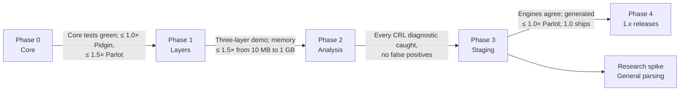

# Creole work items

This folder breaks the [Creole whitepaper](../whitepaper.md) into epics and work items.

- Each epic is a folder under [`active/`](active/), and each work item is a Markdown file inside it.
- Every work item lists what blocks it and what it unblocks. Blockers are hard dependencies: an item should not start until its blockers are done.
- Phases follow the whitepaper's [Roadmap](../whitepaper.md#roadmap). An item can start as soon as its blockers are done, even if earlier phases still have unrelated work open.

**Totals:** 18 epics, 129 work items.

## Roadmap

Within each phase, work is grouped into **waves**. A wave's items depend only on items in earlier waves (of this or an earlier phase), so everything in one wave can run in parallel.

Note: [FND-07](active/01-foundations/FND-07-validate-c-15-features-and-decide-parseresult-t.md) was done on the .NET 11 RC 2 compiler, before GA (expected November 2026), by the maintainer's choice. Its decision ([ADR-0002](docs/decisions/0002-parseresult-as-a-plain-union.md)) unblocks ERR-01. When `global.json` moves to the GA SDK, re-run the FND-07 spike or the tests that rely on unions; [FND-09](active/01-foundations/FND-09-move-to-the-net-11-ga-sdk.md) tracks this.

### Phase 0 — Core

**Scope:** Combinator set, interpreter, error model.  
**Gate:** Core tests green; interpreter at least as fast as Pidgin and within 1.5× of Parlot ([ADR-0003](docs/decisions/0003-numeric-gate-thresholds.md)).

| Wave | Work item | Blocked by |
| --- | --- | --- |
| 1 | ✅ [FND-01](active/01-foundations/FND-01-reserve-the-creole-nuget-package-id.md) Reserve the Creole NuGet package ID | — |
| 1 | ✅ [FND-02](active/01-foundations/FND-02-repository-and-solution-scaffolding.md) Repository and solution scaffolding | — |
| 1 | ✅ [FND-08](active/01-foundations/FND-08-whitepaper-editorial-cleanup.md) Whitepaper editorial cleanup | — |
| 2 | ✅ [FND-03](active/01-foundations/FND-03-continuous-integration.md) Continuous integration | [FND-02](active/01-foundations/FND-02-repository-and-solution-scaffolding.md) |
| 2 | ✅ [FND-04](active/01-foundations/FND-04-test-infrastructure.md) Test infrastructure | [FND-02](active/01-foundations/FND-02-repository-and-solution-scaffolding.md) |
| 2 | ✅ [FND-05](active/01-foundations/FND-05-benchmark-harness.md) Benchmark harness | [FND-02](active/01-foundations/FND-02-repository-and-solution-scaffolding.md) |
| 2 | ✅ [FND-07](active/01-foundations/FND-07-validate-c-15-features-and-decide-parseresult-t.md) Validate C# 15 features and decide `ParseResult<T>` | [FND-02](active/01-foundations/FND-02-repository-and-solution-scaffolding.md); .NET 11 / C# 15 GA (expected November 2026) |
| 2 | ✅ [CORE-01](active/02-core-combinators/CORE-01-grammar-node-model.md) Grammar node model | [FND-02](active/01-foundations/FND-02-repository-and-solution-scaffolding.md) |
| 2 | ✅ [INT-01](active/03-interpreter/INT-01-cursor-and-in-memory-input.md) Cursor and in-memory input | [FND-02](active/01-foundations/FND-02-repository-and-solution-scaffolding.md) |
| 2 | ✅ [SPAN-01](active/05-source-spans/SPAN-01-sourcespan-sourceid-and-linemap.md) SourceSpan, SourceId and LineMap | [FND-02](active/01-foundations/FND-02-repository-and-solution-scaffolding.md) |
| 3 | ✅ [FND-06](active/01-foundations/FND-06-fix-numeric-gate-thresholds.md) Fix numeric gate thresholds | [FND-05](active/01-foundations/FND-05-benchmark-harness.md) |
| 3 | ✅ [CORE-02](active/02-core-combinators/CORE-02-grammar-base-classes-and-authoring-surface.md) Grammar base classes and authoring surface | [CORE-01](active/02-core-combinators/CORE-01-grammar-node-model.md) |
| 3 | ✅ [CORE-07](active/02-core-combinators/CORE-07-repetition-nodes.md) Repetition nodes | [CORE-01](active/02-core-combinators/CORE-01-grammar-node-model.md) |
| 3 | ✅ [CORE-11](active/02-core-combinators/CORE-11-expressionbuild.md) Expression.Build | [CORE-01](active/02-core-combinators/CORE-01-grammar-node-model.md) |
| 3 | ✅ [INT-02](active/03-interpreter/INT-02-plan-lowering-and-cache.md) Plan lowering and cache | [CORE-01](active/02-core-combinators/CORE-01-grammar-node-model.md), [INT-01](active/03-interpreter/INT-01-cursor-and-in-memory-input.md) |
| 3 | ✅ [ERR-01](active/04-errors-and-recovery/ERR-01-error-and-result-types.md) Error and result types | [FND-07](active/01-foundations/FND-07-validate-c-15-features-and-decide-parseresult-t.md), [SPAN-01](active/05-source-spans/SPAN-01-sourcespan-sourceid-and-linemap.md) |
| 4 | ✅ [CORE-03](active/02-core-combinators/CORE-03-primitive-nodes.md) Primitive nodes | [CORE-02](active/02-core-combinators/CORE-02-grammar-base-classes-and-authoring-surface.md) |
| 4 | ✅ [CORE-04](active/02-core-combinators/CORE-04-sequencing-and-mapping-nodes.md) Sequencing and mapping nodes | [CORE-02](active/02-core-combinators/CORE-02-grammar-base-classes-and-authoring-surface.md) |
| 4 | ✅ [CORE-05](active/02-core-combinators/CORE-05-choice-nodes.md) Choice nodes | [CORE-02](active/02-core-combinators/CORE-02-grammar-base-classes-and-authoring-surface.md) |
| 4 | ✅ [CORE-06](active/02-core-combinators/CORE-06-longest.md) Longest | [CORE-02](active/02-core-combinators/CORE-02-grammar-base-classes-and-authoring-surface.md) |
| 4 | ✅ [CORE-08](active/02-core-combinators/CORE-08-control-nodes.md) Control nodes | [CORE-02](active/02-core-combinators/CORE-02-grammar-base-classes-and-authoring-surface.md) |
| 4 | ✅ [CORE-09](active/02-core-combinators/CORE-09-recursion-with-rec.md) Recursion with Rec | [CORE-02](active/02-core-combinators/CORE-02-grammar-base-classes-and-authoring-surface.md), [INT-02](active/03-interpreter/INT-02-plan-lowering-and-cache.md) |
| 4 | ✅ [CORE-13](active/02-core-combinators/CORE-13-extension-members-guard-their-receiver.md) Extension members guard their receiver | [CORE-07](active/02-core-combinators/CORE-07-repetition-nodes.md) |
| 4 | ✅ [ERR-03](active/04-errors-and-recovery/ERR-03-diagnostic-rendering.md) Diagnostic rendering | [ERR-01](active/04-errors-and-recovery/ERR-01-error-and-result-types.md), [SPAN-01](active/05-source-spans/SPAN-01-sourcespan-sourceid-and-linemap.md) |
| 5 | ✅ [CORE-10](active/02-core-combinators/CORE-10-bind-and-linq-query-syntax.md) Bind and LINQ query syntax | [CORE-04](active/02-core-combinators/CORE-04-sequencing-and-mapping-nodes.md) |
| 5 | ✅ [CORE-12](active/02-core-combinators/CORE-12-custom-primitives.md) Custom primitives | [CORE-02](active/02-core-combinators/CORE-02-grammar-base-classes-and-authoring-surface.md), [CORE-03](active/02-core-combinators/CORE-03-primitive-nodes.md), [CORE-06](active/02-core-combinators/CORE-06-longest.md) |
| 5 | ✅ [INT-03](active/03-interpreter/INT-03-execute-the-core-combinators.md) Execute the core combinators | [CORE-03](active/02-core-combinators/CORE-03-primitive-nodes.md), [CORE-04](active/02-core-combinators/CORE-04-sequencing-and-mapping-nodes.md), [CORE-05](active/02-core-combinators/CORE-05-choice-nodes.md), [CORE-06](active/02-core-combinators/CORE-06-longest.md), [CORE-07](active/02-core-combinators/CORE-07-repetition-nodes.md), [CORE-08](active/02-core-combinators/CORE-08-control-nodes.md), [CORE-09](active/02-core-combinators/CORE-09-recursion-with-rec.md), [INT-02](active/03-interpreter/INT-02-plan-lowering-and-cache.md) |
| 6 | ✅ [FND-10](active/01-foundations/FND-10-move-the-parlot-baselines-to-200.md) Move the Parlot baselines to 2.0.0 | [FND-05](active/01-foundations/FND-05-benchmark-harness.md) |
| 6 | ✅ [INT-04](active/03-interpreter/INT-04-execute-bind-expressionbuild-and-custom.md) Execute Bind, Expression.Build and Custom | [CORE-10](active/02-core-combinators/CORE-10-bind-and-linq-query-syntax.md), [CORE-11](active/02-core-combinators/CORE-11-expressionbuild.md), [CORE-12](active/02-core-combinators/CORE-12-custom-primitives.md), [INT-03](active/03-interpreter/INT-03-execute-the-core-combinators.md) |
| 6 | ✅ [INT-05](active/03-interpreter/INT-05-interpreter-lowering-rewrites.md) Interpreter lowering rewrites | [INT-03](active/03-interpreter/INT-03-execute-the-core-combinators.md) |
| 6 | ✅ [INT-06](active/03-interpreter/INT-06-dfa-compiler-for-regular-subtrees.md) DFA compiler for regular subtrees | [INT-03](active/03-interpreter/INT-03-execute-the-core-combinators.md) |
| 6 | ✅ [INT-07](active/03-interpreter/INT-07-recursion-depth-limit.md) Recursion depth limit | [INT-03](active/03-interpreter/INT-03-execute-the-core-combinators.md), [ERR-01](active/04-errors-and-recovery/ERR-01-error-and-result-types.md) |
| 6 | ✅ [ERR-02](active/04-errors-and-recovery/ERR-02-furthest-failure-tracking-and-labels.md) Furthest-failure tracking and labels | [INT-03](active/03-interpreter/INT-03-execute-the-core-combinators.md), [ERR-01](active/04-errors-and-recovery/ERR-01-error-and-result-types.md) |
| 7 | ✅ [INT-08](active/03-interpreter/INT-08-single-layer-parse-api.md) Single-layer Parse API | [INT-03](active/03-interpreter/INT-03-execute-the-core-combinators.md), [INT-07](active/03-interpreter/INT-07-recursion-depth-limit.md), [ERR-02](active/04-errors-and-recovery/ERR-02-furthest-failure-tracking-and-labels.md) |
| 7 | ✅ [INT-09](active/03-interpreter/INT-09-cheaper-automaton-construction.md) Cheaper automaton construction | [INT-06](active/03-interpreter/INT-06-dfa-compiler-for-regular-subtrees.md) |
| 8 | ✅ [INT-11](active/03-interpreter/INT-11-single-layer-parse-over-token-input.md) Single-layer Parse over token input | [INT-08](active/03-interpreter/INT-08-single-layer-parse-api.md) |
| 8 | ✅ [BENCH-01](active/13-benchmarks/BENCH-01-phase-0-speed-gate.md) Phase 0 speed gate **(Phase 0 gate)** | [FND-06](active/01-foundations/FND-06-fix-numeric-gate-thresholds.md), [FND-10](active/01-foundations/FND-10-move-the-parlot-baselines-to-200.md), [INT-05](active/03-interpreter/INT-05-interpreter-lowering-rewrites.md), [INT-06](active/03-interpreter/INT-06-dfa-compiler-for-regular-subtrees.md), [INT-08](active/03-interpreter/INT-08-single-layer-parse-api.md), [ERR-02](active/04-errors-and-recovery/ERR-02-furthest-failure-tracking-and-labels.md) |

### Phase 1 — Layers

**Scope:** Pipelines, buffers and spans, mode channels, streaming.  
**Gate:** Three-layer demo runs; peak retained memory grows at most 1.5× from 10 MB to 1 GB of input ([ADR-0003](docs/decisions/0003-numeric-gate-thresholds.md)).

| Wave | Work item | Blocked by |
| --- | --- | --- |
| 1 | ✅ [LAY-01](active/06-layers-and-pipelines/LAY-01-streambuffer-and-pulling-cursor.md) StreamBuffer and pulling cursor | [INT-01](active/03-interpreter/INT-01-cursor-and-in-memory-input.md) |
| 2 | ✅ [SPAN-02](active/05-source-spans/SPAN-02-out-of-band-span-storage.md) Out-of-band span storage | [SPAN-01](active/05-source-spans/SPAN-01-sourcespan-sourceid-and-linemap.md), [LAY-01](active/06-layers-and-pipelines/LAY-01-streambuffer-and-pulling-cursor.md) |
| 3 | ✅ [ERR-08](active/04-errors-and-recovery/ERR-08-bound-rendered-diagnostics.md) Bound rendered diagnostics | [ERR-03](active/04-errors-and-recovery/ERR-03-diagnostic-rendering.md) |
| 3 | ✅ [LAY-08](active/06-layers-and-pipelines/LAY-08-per-layer-parse-state.md) Per-layer parse state | [CORE-08](active/02-core-combinators/CORE-08-control-nodes.md), [INT-01](active/03-interpreter/INT-01-cursor-and-in-memory-input.md) |
| 4 | [LAY-02](active/06-layers-and-pipelines/LAY-02-marks-and-retention.md) Marks and retention | [INT-03](active/03-interpreter/INT-03-execute-the-core-combinators.md), [LAY-01](active/06-layers-and-pipelines/LAY-01-streambuffer-and-pulling-cursor.md), [LAY-08](active/06-layers-and-pipelines/LAY-08-per-layer-parse-state.md) |
| 4 | [LAY-03](active/06-layers-and-pipelines/LAY-03-layer-abstraction-and-emit.md) Layer abstraction and Emit | [INT-03](active/03-interpreter/INT-03-execute-the-core-combinators.md), [LAY-01](active/06-layers-and-pipelines/LAY-01-streambuffer-and-pulling-cursor.md) |
| 5 | [ERR-04](active/04-errors-and-recovery/ERR-04-diagnostic-withdrawal.md) Diagnostic withdrawal | [ERR-01](active/04-errors-and-recovery/ERR-01-error-and-result-types.md), [LAY-02](active/06-layers-and-pipelines/LAY-02-marks-and-retention.md) |
| 5 | [SPAN-03](active/05-source-spans/SPAN-03-synthetic-items.md) Synthetic items | [SPAN-02](active/05-source-spans/SPAN-02-out-of-band-span-storage.md), [LAY-03](active/06-layers-and-pipelines/LAY-03-layer-abstraction-and-emit.md) |
| 5 | [SPAN-04](active/05-source-spans/SPAN-04-span-combinators.md) Span combinators | [SPAN-02](active/05-source-spans/SPAN-02-out-of-band-span-storage.md), [LAY-03](active/06-layers-and-pipelines/LAY-03-layer-abstraction-and-emit.md) |
| 5 | [SPAN-05](active/05-source-spans/SPAN-05-trivia-attach-mode.md) Trivia attach mode | [SPAN-02](active/05-source-spans/SPAN-02-out-of-band-span-storage.md), [LAY-03](active/06-layers-and-pipelines/LAY-03-layer-abstraction-and-emit.md) |
| 5 | [SPAN-06](active/05-source-spans/SPAN-06-byte-sources-and-the-decoding-layer.md) Byte sources and the decoding layer | [SPAN-02](active/05-source-spans/SPAN-02-out-of-band-span-storage.md), [LAY-03](active/06-layers-and-pipelines/LAY-03-layer-abstraction-and-emit.md) |
| 5 | [LAY-04](active/06-layers-and-pipelines/LAY-04-layer-local-state.md) Layer-local state | [LAY-02](active/06-layers-and-pipelines/LAY-02-marks-and-retention.md), [LAY-03](active/06-layers-and-pipelines/LAY-03-layer-abstraction-and-emit.md) |
| 5 | [LAY-05](active/06-layers-and-pipelines/LAY-05-pipeline-api-and-sources.md) Pipeline API and sources | [ERR-01](active/04-errors-and-recovery/ERR-01-error-and-result-types.md), [LAY-03](active/06-layers-and-pipelines/LAY-03-layer-abstraction-and-emit.md) |
| 5 | [LAY-06](active/06-layers-and-pipelines/LAY-06-buffer-size-limit.md) Buffer size limit | [ERR-02](active/04-errors-and-recovery/ERR-02-furthest-failure-tracking-and-labels.md), [LAY-02](active/06-layers-and-pipelines/LAY-02-marks-and-retention.md) |
| 5 | [MODE-01](active/07-mode-channels/MODE-01-mode-channels-and-layermodal.md) Mode channels and Layer.Modal | [LAY-03](active/06-layers-and-pipelines/LAY-03-layer-abstraction-and-emit.md) |
| 5 | [STRM-01](active/08-streaming/STRM-01-starved-outcome.md) Starved outcome | [LAY-02](active/06-layers-and-pipelines/LAY-02-marks-and-retention.md) |
| 6 | [LAY-07](active/06-layers-and-pipelines/LAY-07-three-layer-demo-and-bounded-memory-check.md) Three-layer demo and bounded-memory check **(Phase 1 gate)** | [SPAN-03](active/05-source-spans/SPAN-03-synthetic-items.md), [LAY-04](active/06-layers-and-pipelines/LAY-04-layer-local-state.md), [LAY-05](active/06-layers-and-pipelines/LAY-05-pipeline-api-and-sources.md), [LAY-06](active/06-layers-and-pipelines/LAY-06-buffer-size-limit.md) |
| 6 | [MODE-02](active/07-mode-channels/MODE-02-invalidation-rule.md) Invalidation rule | [ERR-04](active/04-errors-and-recovery/ERR-04-diagnostic-withdrawal.md), [LAY-02](active/06-layers-and-pipelines/LAY-02-marks-and-retention.md), [LAY-08](active/06-layers-and-pipelines/LAY-08-per-layer-parse-state.md), [MODE-01](active/07-mode-channels/MODE-01-mode-channels-and-layermodal.md) |
| 6 | [MODE-05](active/07-mode-channels/MODE-05-mode-payloads.md) Mode payloads | [MODE-01](active/07-mode-channels/MODE-01-mode-channels-and-layermodal.md) |
| 6 | [STRM-02](active/08-streaming/STRM-02-restart-protocol-and-parsemanyasync.md) Restart protocol and ParseManyAsync | [SPAN-06](active/05-source-spans/SPAN-06-byte-sources-and-the-decoding-layer.md), [LAY-05](active/06-layers-and-pipelines/LAY-05-pipeline-api-and-sources.md), [LAY-08](active/06-layers-and-pipelines/LAY-08-per-layer-parse-state.md), [STRM-01](active/08-streaming/STRM-01-starved-outcome.md) |
| 6 | [STRM-04](active/08-streaming/STRM-04-huge-single-documents.md) Huge single documents | [LAY-05](active/06-layers-and-pipelines/LAY-05-pipeline-api-and-sources.md) |
| 7 | [INT-12](active/03-interpreter/INT-12-close-the-interpreter-test-gaps-bench-01-left.md) Close the interpreter test gaps BENCH-01 left | [INT-06](active/03-interpreter/INT-06-dfa-compiler-for-regular-subtrees.md), [BENCH-01](active/13-benchmarks/BENCH-01-phase-0-speed-gate.md) |
| 7 | [MODE-03](active/07-mode-channels/MODE-03-rollback-rule.md) Rollback rule | [MODE-02](active/07-mode-channels/MODE-02-invalidation-rule.md) |
| 7 | [MODE-04](active/07-mode-channels/MODE-04-multi-layer-invalidation-cascade.md) Multi-layer invalidation cascade | [MODE-02](active/07-mode-channels/MODE-02-invalidation-rule.md) |
| 7 | [STRM-03](active/08-streaming/STRM-03-streaming-diagnostics.md) Streaming diagnostics | [ERR-03](active/04-errors-and-recovery/ERR-03-diagnostic-rendering.md), [STRM-02](active/08-streaming/STRM-02-restart-protocol-and-parsemanyasync.md) |
| 7 | [BENCH-04](active/13-benchmarks/BENCH-04-revisit-string-handling-in-the-json-benchmark-grammar.md) Revisit string handling in the JSON benchmark grammar | [BENCH-01](active/13-benchmarks/BENCH-01-phase-0-speed-gate.md) |
| 8 | [MODE-06](active/07-mode-channels/MODE-06-model-based-tests-for-mode-rollback.md) Model-based tests for mode rollback | [FND-04](active/01-foundations/FND-04-test-infrastructure.md), [MODE-03](active/07-mode-channels/MODE-03-rollback-rule.md), [MODE-04](active/07-mode-channels/MODE-04-multi-layer-invalidation-cascade.md) |

### Phase 2 — Analysis

**Scope:** Analyzers, deterministic mode, recovery, grammar-author tooling.  
**Gate:** Every CRL error and warning caught at build time, with no false positives on near misses ([ADR-0003](docs/decisions/0003-numeric-gate-thresholds.md)).

| Wave | Work item | Blocked by |
| --- | --- | --- |
| 1 | [FND-09](active/01-foundations/FND-09-move-to-the-net-11-ga-sdk.md) Move to the .NET 11 GA SDK | [FND-07](active/01-foundations/FND-07-validate-c-15-features-and-decide-parseresult-t.md), [CORE-04](active/02-core-combinators/CORE-04-sequencing-and-mapping-nodes.md); .NET 11 / C# 15 GA (expected November 2026) |
| 1 | [CORE-14](active/02-core-combinators/CORE-14-choices-beyond-16-alternatives.md) Choices beyond 16 alternatives | [CORE-05](active/02-core-combinators/CORE-05-choice-nodes.md), [CORE-06](active/02-core-combinators/CORE-06-longest.md) |
| 2 | [RSLN-04](active/10-roslyn-analyzers/RSLN-04-crl0004-forward-field-reference-analyzer.md) CRL0004 forward field reference analyzer | [FND-02](active/01-foundations/FND-02-repository-and-solution-scaffolding.md), [FND-09](active/01-foundations/FND-09-move-to-the-net-11-ga-sdk.md), [CORE-09](active/02-core-combinators/CORE-09-recursion-with-rec.md) |
| 2 | [GEN-11](active/11-source-generator/GEN-11-runtime-support-surface-for-generated-code.md) Runtime support surface for generated code | [LAY-08](active/06-layers-and-pipelines/LAY-08-per-layer-parse-state.md) |
| 3 | [ANA-01](active/09-static-analysis/ANA-01-grammar-property-analysis.md) Grammar property analysis | [CORE-03](active/02-core-combinators/CORE-03-primitive-nodes.md), [CORE-04](active/02-core-combinators/CORE-04-sequencing-and-mapping-nodes.md), [CORE-05](active/02-core-combinators/CORE-05-choice-nodes.md), [CORE-06](active/02-core-combinators/CORE-06-longest.md), [CORE-07](active/02-core-combinators/CORE-07-repetition-nodes.md), [CORE-08](active/02-core-combinators/CORE-08-control-nodes.md), [CORE-09](active/02-core-combinators/CORE-09-recursion-with-rec.md), [CORE-10](active/02-core-combinators/CORE-10-bind-and-linq-query-syntax.md), [CORE-11](active/02-core-combinators/CORE-11-expressionbuild.md), [CORE-12](active/02-core-combinators/CORE-12-custom-primitives.md), [LAY-03](active/06-layers-and-pipelines/LAY-03-layer-abstraction-and-emit.md), [INT-06](active/03-interpreter/INT-06-dfa-compiler-for-regular-subtrees.md) |
| 4 | [INT-10](active/03-interpreter/INT-10-dispatched-longest-measured-against-the-automaton.md) Dispatched Longest, measured against the automaton | [INT-06](active/03-interpreter/INT-06-dfa-compiler-for-regular-subtrees.md), [INT-09](active/03-interpreter/INT-09-cheaper-automaton-construction.md) |
| 4 | [ERR-06](active/04-errors-and-recovery/ERR-06-orinsert-for-missing-items.md) OrInsert for missing items | [ERR-02](active/04-errors-and-recovery/ERR-02-furthest-failure-tracking-and-labels.md), [SPAN-03](active/05-source-spans/SPAN-03-synthetic-items.md) |
| 4 | [SPAN-07](active/05-source-spans/SPAN-07-embedded-languages.md) Embedded languages | [SPAN-02](active/05-source-spans/SPAN-02-out-of-band-span-storage.md), [LAY-05](active/06-layers-and-pipelines/LAY-05-pipeline-api-and-sources.md) |
| 4 | [ANA-02](active/09-static-analysis/ANA-02-analysis-report-and-debug-enforcement.md) Analysis report and Debug enforcement | [ANA-01](active/09-static-analysis/ANA-01-grammar-property-analysis.md) |
| 4 | [RSLN-01](active/10-roslyn-analyzers/RSLN-01-roslyn-grammar-reader.md) Roslyn grammar reader | [FND-02](active/01-foundations/FND-02-repository-and-solution-scaffolding.md), [CORE-02](active/02-core-combinators/CORE-02-grammar-base-classes-and-authoring-surface.md), [CORE-10](active/02-core-combinators/CORE-10-bind-and-linq-query-syntax.md), [CORE-11](active/02-core-combinators/CORE-11-expressionbuild.md), [CORE-12](active/02-core-combinators/CORE-12-custom-primitives.md), [CORE-14](active/02-core-combinators/CORE-14-choices-beyond-16-alternatives.md), [LAY-03](active/06-layers-and-pipelines/LAY-03-layer-abstraction-and-emit.md), [MODE-01](active/07-mode-channels/MODE-01-mode-channels-and-layermodal.md) |
| 4 | [TOOL-01](active/12-grammar-author-tooling/TOOL-01-creoletesting-assertions.md) Creole.Testing assertions | [FND-04](active/01-foundations/FND-04-test-infrastructure.md), [ERR-03](active/04-errors-and-recovery/ERR-03-diagnostic-rendering.md), [LAY-05](active/06-layers-and-pipelines/LAY-05-pipeline-api-and-sources.md) |
| 4 | [TOOL-02](active/12-grammar-author-tooling/TOOL-02-tracing.md) Tracing | [INT-03](active/03-interpreter/INT-03-execute-the-core-combinators.md), [LAY-05](active/06-layers-and-pipelines/LAY-05-pipeline-api-and-sources.md) |
| 4 | [TOOL-04](active/12-grammar-author-tooling/TOOL-04-grammar-fuzzing.md) Grammar fuzzing | [ANA-01](active/09-static-analysis/ANA-01-grammar-property-analysis.md) |
| 5 | [ERR-05](active/04-errors-and-recovery/ERR-05-recover-combinator-and-strategies.md) Recover combinator and strategies | [ERR-02](active/04-errors-and-recovery/ERR-02-furthest-failure-tracking-and-labels.md), [ERR-04](active/04-errors-and-recovery/ERR-04-diagnostic-withdrawal.md), [LAY-04](active/06-layers-and-pipelines/LAY-04-layer-local-state.md), [LAY-08](active/06-layers-and-pipelines/LAY-08-per-layer-parse-state.md), [MODE-02](active/07-mode-channels/MODE-02-invalidation-rule.md), [STRM-01](active/08-streaming/STRM-01-starved-outcome.md) |
| 5 | [ANA-03](active/09-static-analysis/ANA-03-loop-and-recursion-checks.md) Loop and recursion checks | [LAY-03](active/06-layers-and-pipelines/LAY-03-layer-abstraction-and-emit.md), [ANA-02](active/09-static-analysis/ANA-02-analysis-report-and-debug-enforcement.md) |
| 5 | [ANA-04](active/09-static-analysis/ANA-04-choice-checks.md) Choice checks | [INT-06](active/03-interpreter/INT-06-dfa-compiler-for-regular-subtrees.md), [ANA-02](active/09-static-analysis/ANA-02-analysis-report-and-debug-enforcement.md) |
| 5 | [ANA-05](active/09-static-analysis/ANA-05-informational-and-hygiene-checks.md) Informational and hygiene checks | [ANA-02](active/09-static-analysis/ANA-02-analysis-report-and-debug-enforcement.md) |
| 5 | [ANA-06](active/09-static-analysis/ANA-06-deterministic-mode.md) Deterministic mode | [INT-05](active/03-interpreter/INT-05-interpreter-lowering-rewrites.md), [LAY-02](active/06-layers-and-pipelines/LAY-02-marks-and-retention.md), [MODE-01](active/07-mode-channels/MODE-01-mode-channels-and-layermodal.md), [ANA-01](active/09-static-analysis/ANA-01-grammar-property-analysis.md), [ANA-02](active/09-static-analysis/ANA-02-analysis-report-and-debug-enforcement.md) |
| 5 | [ANA-07](active/09-static-analysis/ANA-07-linear-maximal-munch.md) Linear maximal munch | [INT-06](active/03-interpreter/INT-06-dfa-compiler-for-regular-subtrees.md), [ANA-02](active/09-static-analysis/ANA-02-analysis-report-and-debug-enforcement.md) |
| 5 | [ANA-08](active/09-static-analysis/ANA-08-custom-scanner-contract-checks.md) Custom scanner contract checks | [INT-04](active/03-interpreter/INT-04-execute-bind-expressionbuild-and-custom.md), [ANA-02](active/09-static-analysis/ANA-02-analysis-report-and-debug-enforcement.md) |
| 5 | [RSLN-02](active/10-roslyn-analyzers/RSLN-02-share-the-analysis-engine-with-the-roslyn-component.md) Share the analysis engine with the Roslyn component | [ANA-01](active/09-static-analysis/ANA-01-grammar-property-analysis.md), [RSLN-01](active/10-roslyn-analyzers/RSLN-01-roslyn-grammar-reader.md) |
| 5 | [RSLN-05](active/10-roslyn-analyzers/RSLN-05-grammar-class-hygiene-analyzers.md) Grammar class hygiene analyzers | [RSLN-01](active/10-roslyn-analyzers/RSLN-01-roslyn-grammar-reader.md) |
| 5 | [TOOL-03](active/12-grammar-author-tooling/TOOL-03-explain.md) Explain | [ERR-02](active/04-errors-and-recovery/ERR-02-furthest-failure-tracking-and-labels.md), [TOOL-02](active/12-grammar-author-tooling/TOOL-02-tracing.md) |
| 6 | [ERR-07](active/04-errors-and-recovery/ERR-07-lexer-recovery-and-cascade-suppression.md) Lexer recovery and cascade suppression | [ERR-05](active/04-errors-and-recovery/ERR-05-recover-combinator-and-strategies.md), [LAY-03](active/06-layers-and-pipelines/LAY-03-layer-abstraction-and-emit.md) |
| 6 | [RSLN-03](active/10-roslyn-analyzers/RSLN-03-build-time-diagnostic-reporting.md) Build-time diagnostic reporting | [ANA-03](active/09-static-analysis/ANA-03-loop-and-recursion-checks.md), [ANA-04](active/09-static-analysis/ANA-04-choice-checks.md), [ANA-05](active/09-static-analysis/ANA-05-informational-and-hygiene-checks.md), [ANA-06](active/09-static-analysis/ANA-06-deterministic-mode.md), [RSLN-02](active/10-roslyn-analyzers/RSLN-02-share-the-analysis-engine-with-the-roslyn-component.md) |
| 6 | [REL-01](active/14-release/REL-01-worked-example-samples.md) Worked-example samples | [CORE-11](active/02-core-combinators/CORE-11-expressionbuild.md), [INT-04](active/03-interpreter/INT-04-execute-bind-expressionbuild-and-custom.md), [LAY-07](active/06-layers-and-pipelines/LAY-07-three-layer-demo-and-bounded-memory-check.md), [MODE-03](active/07-mode-channels/MODE-03-rollback-rule.md), [ANA-06](active/09-static-analysis/ANA-06-deterministic-mode.md) |
| 7 | [RSLN-06](active/10-roslyn-analyzers/RSLN-06-code-fixes-for-grammar-bugs.md) Code fixes for grammar bugs | [RSLN-03](active/10-roslyn-analyzers/RSLN-03-build-time-diagnostic-reporting.md), [RSLN-04](active/10-roslyn-analyzers/RSLN-04-crl0004-forward-field-reference-analyzer.md) |
| 7 | [RSLN-07](active/10-roslyn-analyzers/RSLN-07-grammar-bug-corpus.md) Grammar bug corpus **(Phase 2 gate)** | [ANA-07](active/09-static-analysis/ANA-07-linear-maximal-munch.md), [ANA-08](active/09-static-analysis/ANA-08-custom-scanner-contract-checks.md), [RSLN-03](active/10-roslyn-analyzers/RSLN-03-build-time-diagnostic-reporting.md), [RSLN-04](active/10-roslyn-analyzers/RSLN-04-crl0004-forward-field-reference-analyzer.md), [RSLN-05](active/10-roslyn-analyzers/RSLN-05-grammar-class-hygiene-analyzers.md) |

### Phase 3 — Staging

**Scope:** Source generator, helper inlining, engine agreement, 1.0 release.  
**Gate:** Engines agree on 10,000 random cases; generated engine as fast as Parlot; 1.0 ships ([ADR-0003](docs/decisions/0003-numeric-gate-thresholds.md)).

| Wave | Work item | Blocked by |
| --- | --- | --- |
| 1 | [GEN-01](active/11-source-generator/GEN-01-generator-skeleton-and-registration.md) Generator skeleton and registration | [INT-02](active/03-interpreter/INT-02-plan-lowering-and-cache.md), [RSLN-01](active/10-roslyn-analyzers/RSLN-01-roslyn-grammar-reader.md), [GEN-11](active/11-source-generator/GEN-11-runtime-support-surface-for-generated-code.md) |
| 2 | [GEN-02](active/11-source-generator/GEN-02-emit-the-core-combinators.md) Emit the core combinators | [INT-03](active/03-interpreter/INT-03-execute-the-core-combinators.md), [ERR-02](active/04-errors-and-recovery/ERR-02-furthest-failure-tracking-and-labels.md), [GEN-01](active/11-source-generator/GEN-01-generator-skeleton-and-registration.md), [GEN-11](active/11-source-generator/GEN-11-runtime-support-surface-for-generated-code.md) |
| 2 | [TOOL-05](active/12-grammar-author-tooling/TOOL-05-ebnf-and-railroad-diagram-export.md) EBNF and railroad diagram export | [CORE-03](active/02-core-combinators/CORE-03-primitive-nodes.md), [CORE-04](active/02-core-combinators/CORE-04-sequencing-and-mapping-nodes.md), [CORE-05](active/02-core-combinators/CORE-05-choice-nodes.md), [CORE-07](active/02-core-combinators/CORE-07-repetition-nodes.md), [CORE-08](active/02-core-combinators/CORE-08-control-nodes.md), [CORE-11](active/02-core-combinators/CORE-11-expressionbuild.md), [GEN-01](active/11-source-generator/GEN-01-generator-skeleton-and-registration.md) |
| 3 | [GEN-03](active/11-source-generator/GEN-03-lambda-and-helper-inlining.md) Lambda and helper inlining | [CORE-10](active/02-core-combinators/CORE-10-bind-and-linq-query-syntax.md), [GEN-02](active/11-source-generator/GEN-02-emit-the-core-combinators.md) |
| 3 | [GEN-04](active/11-source-generator/GEN-04-interpreter-fallback-and-crl0301.md) Interpreter fallback and CRL0301 | [GEN-02](active/11-source-generator/GEN-02-emit-the-core-combinators.md) |
| 3 | [GEN-05](active/11-source-generator/GEN-05-generated-dfas-scans-and-jump-tables.md) Generated DFAs, scans and jump tables | [INT-06](active/03-interpreter/INT-06-dfa-compiler-for-regular-subtrees.md), [INT-10](active/03-interpreter/INT-10-dispatched-longest-measured-against-the-automaton.md), [ANA-06](active/09-static-analysis/ANA-06-deterministic-mode.md), [ANA-07](active/09-static-analysis/ANA-07-linear-maximal-munch.md), [GEN-02](active/11-source-generator/GEN-02-emit-the-core-combinators.md) |
| 3 | [GEN-06](active/11-source-generator/GEN-06-generated-layers-modes-recovery-and-streaming.md) Generated layers, modes, recovery and streaming | [INT-04](active/03-interpreter/INT-04-execute-bind-expressionbuild-and-custom.md), [INT-07](active/03-interpreter/INT-07-recursion-depth-limit.md), [ERR-05](active/04-errors-and-recovery/ERR-05-recover-combinator-and-strategies.md), [ERR-06](active/04-errors-and-recovery/ERR-06-orinsert-for-missing-items.md), [ERR-07](active/04-errors-and-recovery/ERR-07-lexer-recovery-and-cascade-suppression.md), [LAY-04](active/06-layers-and-pipelines/LAY-04-layer-local-state.md), [MODE-04](active/07-mode-channels/MODE-04-multi-layer-invalidation-cascade.md), [STRM-01](active/08-streaming/STRM-01-starved-outcome.md), [GEN-02](active/11-source-generator/GEN-02-emit-the-core-combinators.md) |
| 3 | [GEN-07](active/11-source-generator/GEN-07-debugging-generated-code.md) Debugging generated code | [GEN-02](active/11-source-generator/GEN-02-emit-the-core-combinators.md) |
| 4 | [GEN-08](active/11-source-generator/GEN-08-differential-engine-agreement-tests.md) Differential engine-agreement tests **(Phase 3 gate)** | [FND-04](active/01-foundations/FND-04-test-infrastructure.md), [GEN-03](active/11-source-generator/GEN-03-lambda-and-helper-inlining.md), [GEN-04](active/11-source-generator/GEN-04-interpreter-fallback-and-crl0301.md), [GEN-05](active/11-source-generator/GEN-05-generated-dfas-scans-and-jump-tables.md), [GEN-06](active/11-source-generator/GEN-06-generated-layers-modes-recovery-and-streaming.md), [TOOL-04](active/12-grammar-author-tooling/TOOL-04-grammar-fuzzing.md) |
| 4 | [GEN-09](active/11-source-generator/GEN-09-native-aot-and-trimming-validation.md) Native AOT and trimming validation | [FND-03](active/01-foundations/FND-03-continuous-integration.md), [CORE-10](active/02-core-combinators/CORE-10-bind-and-linq-query-syntax.md), [GEN-06](active/11-source-generator/GEN-06-generated-layers-modes-recovery-and-streaming.md) |
| 4 | [GEN-10](active/11-source-generator/GEN-10-measure-the-interpreter-fallback-rate.md) Measure the interpreter fallback rate | [GEN-04](active/11-source-generator/GEN-04-interpreter-fallback-and-crl0301.md), [REL-01](active/14-release/REL-01-worked-example-samples.md) |
| 4 | [BENCH-02](active/13-benchmarks/BENCH-02-full-benchmark-suite.md) Full benchmark suite | [FND-05](active/01-foundations/FND-05-benchmark-harness.md), [ERR-07](active/04-errors-and-recovery/ERR-07-lexer-recovery-and-cascade-suppression.md), [STRM-02](active/08-streaming/STRM-02-restart-protocol-and-parsemanyasync.md), [GEN-05](active/11-source-generator/GEN-05-generated-dfas-scans-and-jump-tables.md), [GEN-06](active/11-source-generator/GEN-06-generated-layers-modes-recovery-and-streaming.md), [BENCH-04](active/13-benchmarks/BENCH-04-revisit-string-handling-in-the-json-benchmark-grammar.md) |
| 4 | [REL-02](active/14-release/REL-02-documentation.md) Documentation | [RSLN-03](active/10-roslyn-analyzers/RSLN-03-build-time-diagnostic-reporting.md), [GEN-04](active/11-source-generator/GEN-04-interpreter-fallback-and-crl0301.md), [TOOL-01](active/12-grammar-author-tooling/TOOL-01-creoletesting-assertions.md) |
| 4 | [REL-04](active/14-release/REL-04-public-api-review-and-freeze.md) Public API review and freeze | [FND-07](active/01-foundations/FND-07-validate-c-15-features-and-decide-parseresult-t.md), [FND-09](active/01-foundations/FND-09-move-to-the-net-11-ga-sdk.md), [CORE-13](active/02-core-combinators/CORE-13-extension-members-guard-their-receiver.md), [CORE-14](active/02-core-combinators/CORE-14-choices-beyond-16-alternatives.md), [ERR-07](active/04-errors-and-recovery/ERR-07-lexer-recovery-and-cascade-suppression.md), [SPAN-07](active/05-source-spans/SPAN-07-embedded-languages.md), [STRM-03](active/08-streaming/STRM-03-streaming-diagnostics.md), [GEN-06](active/11-source-generator/GEN-06-generated-layers-modes-recovery-and-streaming.md), [TOOL-01](active/12-grammar-author-tooling/TOOL-01-creoletesting-assertions.md) |
| 5 | [TOOL-06](active/12-grammar-author-tooling/TOOL-06-engineagreementcheck.md) EngineAgreement.Check | [GEN-08](active/11-source-generator/GEN-08-differential-engine-agreement-tests.md) |
| 5 | [BENCH-03](active/13-benchmarks/BENCH-03-phase-3-speed-gate.md) Phase 3 speed gate **(Phase 3 gate)** | [FND-06](active/01-foundations/FND-06-fix-numeric-gate-thresholds.md), [FND-10](active/01-foundations/FND-10-move-the-parlot-baselines-to-200.md), [BENCH-02](active/13-benchmarks/BENCH-02-full-benchmark-suite.md) |
| 5 | [REL-03](active/14-release/REL-03-migration-guides.md) Migration guides | [BENCH-02](active/13-benchmarks/BENCH-02-full-benchmark-suite.md) |
| 6 | [REL-05](active/14-release/REL-05-ship-10.md) Ship 1.0 **(1.0 release)** | [FND-01](active/01-foundations/FND-01-reserve-the-creole-nuget-package-id.md), [MODE-06](active/07-mode-channels/MODE-06-model-based-tests-for-mode-rollback.md), [GEN-07](active/11-source-generator/GEN-07-debugging-generated-code.md), [GEN-08](active/11-source-generator/GEN-08-differential-engine-agreement-tests.md), [GEN-09](active/11-source-generator/GEN-09-native-aot-and-trimming-validation.md), [GEN-10](active/11-source-generator/GEN-10-measure-the-interpreter-fallback-rate.md), [TOOL-06](active/12-grammar-author-tooling/TOOL-06-engineagreementcheck.md), [BENCH-02](active/13-benchmarks/BENCH-02-full-benchmark-suite.md), [BENCH-03](active/13-benchmarks/BENCH-03-phase-3-speed-gate.md), [REL-02](active/14-release/REL-02-documentation.md), [REL-03](active/14-release/REL-03-migration-guides.md), [REL-04](active/14-release/REL-04-public-api-review-and-freeze.md) |

### Phase 4 — 1.x releases

**Scope:** Incremental re-parsing, layer fusion, resumable async.  
**Gate:** Each ships behind its own gate, with thresholds in [ADR-0003](docs/decisions/0003-numeric-gate-thresholds.md).

| Wave | Work item | Blocked by |
| --- | --- | --- |
| 1 | [INC-01](active/15-incremental-reparsing/INC-01-parsesession-and-retained-buffers.md) ParseSession and retained buffers | [LAY-05](active/06-layers-and-pipelines/LAY-05-pipeline-api-and-sources.md), [GEN-08](active/11-source-generator/GEN-08-differential-engine-agreement-tests.md) |
| 1 | [FUS-01](active/16-layer-fusion/FUS-01-fusion-feasibility-measurement.md) Fusion feasibility measurement | [FND-06](active/01-foundations/FND-06-fix-numeric-gate-thresholds.md), [GEN-05](active/11-source-generator/GEN-05-generated-dfas-scans-and-jump-tables.md), [BENCH-02](active/13-benchmarks/BENCH-02-full-benchmark-suite.md) |
| 1 | [RES-01](active/17-resumable-async/RES-01-resumable-async-measurement.md) Resumable async measurement | [FND-06](active/01-foundations/FND-06-fix-numeric-gate-thresholds.md), [STRM-02](active/08-streaming/STRM-02-restart-protocol-and-parsemanyasync.md), [BENCH-02](active/13-benchmarks/BENCH-02-full-benchmark-suite.md) |
| 2 | [INC-02](active/15-incremental-reparsing/INC-02-examined-extent-tracking.md) Examined-extent tracking | [INC-01](active/15-incremental-reparsing/INC-01-parsesession-and-retained-buffers.md) |
| 2 | [FUS-02](active/16-layer-fusion/FUS-02-fused-code-emission.md) Fused code emission | [FUS-01](active/16-layer-fusion/FUS-01-fusion-feasibility-measurement.md) |
| 2 | [RES-02](active/17-resumable-async/RES-02-resumable-generated-parsers.md) Resumable generated parsers **(Resumable async gate)** | [GEN-06](active/11-source-generator/GEN-06-generated-layers-modes-recovery-and-streaming.md), [RES-01](active/17-resumable-async/RES-01-resumable-async-measurement.md) |
| 3 | [INC-03](active/15-incremental-reparsing/INC-03-layer-item-reuse.md) Layer item reuse | [MODE-03](active/07-mode-channels/MODE-03-rollback-rule.md), [INC-02](active/15-incremental-reparsing/INC-02-examined-extent-tracking.md) |
| 3 | [FUS-03](active/16-layer-fusion/FUS-03-fusion-with-modes-and-custom-scanners.md) Fusion with modes and custom scanners | [CORE-12](active/02-core-combinators/CORE-12-custom-primitives.md), [MODE-04](active/07-mode-channels/MODE-04-multi-layer-invalidation-cascade.md), [FUS-02](active/16-layer-fusion/FUS-02-fused-code-emission.md) |
| 3 | [FUS-04](active/16-layer-fusion/FUS-04-fuse-through-stateless-item-layers.md) Fuse through stateless item layers | [FUS-02](active/16-layer-fusion/FUS-02-fused-code-emission.md) |
| 4 | [INC-04](active/15-incremental-reparsing/INC-04-reusable-parser-rules.md) Reusable parser rules | [LAY-08](active/06-layers-and-pipelines/LAY-08-per-layer-parse-state.md), [INC-03](active/15-incremental-reparsing/INC-03-layer-item-reuse.md) |
| 4 | [FUS-05](active/16-layer-fusion/FUS-05-fusion-gate.md) Fusion gate **(Fusion gate)** | [GEN-08](active/11-source-generator/GEN-08-differential-engine-agreement-tests.md), [FUS-03](active/16-layer-fusion/FUS-03-fusion-with-modes-and-custom-scanners.md), [FUS-04](active/16-layer-fusion/FUS-04-fuse-through-stateless-item-layers.md) |
| 5 | [INC-05](active/15-incremental-reparsing/INC-05-session-span-table.md) Session span table | [SPAN-04](active/05-source-spans/SPAN-04-span-combinators.md), [INC-04](active/15-incremental-reparsing/INC-04-reusable-parser-rules.md) |
| 5 | [INC-06](active/15-incremental-reparsing/INC-06-crl0205-stale-span-analyzer.md) CRL0205 stale span analyzer | [RSLN-03](active/10-roslyn-analyzers/RSLN-03-build-time-diagnostic-reporting.md), [INC-04](active/15-incremental-reparsing/INC-04-reusable-parser-rules.md) |
| 6 | [INC-07](active/15-incremental-reparsing/INC-07-incremental-re-parsing-gate.md) Incremental re-parsing gate **(Incremental gate)** | [FND-06](active/01-foundations/FND-06-fix-numeric-gate-thresholds.md), [INC-05](active/15-incremental-reparsing/INC-05-session-span-table.md), [INC-06](active/15-incremental-reparsing/INC-06-crl0205-stale-span-analyzer.md) |

### Research spike — General parsing (post-1.0)

**Scope:** GLL backend over a declarative subset.  
**Gate:** A documented decision.

| Wave | Work item | Blocked by |
| --- | --- | --- |
| 1 | [GLL-01](active/18-general-parsing-spike/GLL-01-define-the-declarative-subset.md) Define the declarative subset | [ANA-01](active/09-static-analysis/ANA-01-grammar-property-analysis.md) |
| 2 | [GLL-02](active/18-general-parsing-spike/GLL-02-gll-interpreter-prototype.md) GLL interpreter prototype | [GLL-01](active/18-general-parsing-spike/GLL-01-define-the-declarative-subset.md) |
| 3 | [GLL-03](active/18-general-parsing-spike/GLL-03-disambiguation-filters.md) Disambiguation filters | [GLL-02](active/18-general-parsing-spike/GLL-02-gll-interpreter-prototype.md) |
| 6 | [GLL-04](active/18-general-parsing-spike/GLL-04-general-parsing-measurements.md) General parsing measurements | [BENCH-02](active/13-benchmarks/BENCH-02-full-benchmark-suite.md), [GLL-03](active/18-general-parsing-spike/GLL-03-disambiguation-filters.md) |
| 7 | [GLL-05](active/18-general-parsing-spike/GLL-05-general-parsing-decision.md) General parsing decision **(Spike decision)** | [GLL-04](active/18-general-parsing-spike/GLL-04-general-parsing-measurements.md) |

### Critical path to 1.0

The longest dependency chains to [REL-05 Ship 1.0](active/14-release/REL-05-ship-10.md) are 14 cards long, and 10 chains tie for that length. Every one of them runs through these cards, so delays on them delay 1.0 directly:

[FND-02](active/01-foundations/FND-02-repository-and-solution-scaffolding.md) → [CORE-01](active/02-core-combinators/CORE-01-grammar-node-model.md) → [CORE-02](active/02-core-combinators/CORE-02-grammar-base-classes-and-authoring-surface.md) → [CORE-03](active/02-core-combinators/CORE-03-primitive-nodes.md) → [INT-03](active/03-interpreter/INT-03-execute-the-core-combinators.md) → … → [REL-05](active/14-release/REL-05-ship-10.md)

### In progress

Cards whose Status is Researching, Designing or Building:

- [LAY-03](active/06-layers-and-pipelines/LAY-03-layer-abstraction-and-emit.md) Layer abstraction and Emit — Build

### Can start now

These items have all their blockers done:

- [CORE-14](active/02-core-combinators/CORE-14-choices-beyond-16-alternatives.md) Choices beyond 16 alternatives
- [INT-10](active/03-interpreter/INT-10-dispatched-longest-measured-against-the-automaton.md) Dispatched Longest, measured against the automaton
- [INT-12](active/03-interpreter/INT-12-close-the-interpreter-test-gaps-bench-01-left.md) Close the interpreter test gaps BENCH-01 left
- [LAY-02](active/06-layers-and-pipelines/LAY-02-marks-and-retention.md) Marks and retention
- [GEN-11](active/11-source-generator/GEN-11-runtime-support-surface-for-generated-code.md) Runtime support surface for generated code
- [BENCH-04](active/13-benchmarks/BENCH-04-revisit-string-handling-in-the-json-benchmark-grammar.md) Revisit string handling in the JSON benchmark grammar

## Epics

### FND — Foundations

Repository, CI, test and benchmark infrastructure, and the decisions code will depend on. Folder: [`active/01-foundations/`](active/01-foundations/).

| Work item | Phase | Blocked by |
| --- | --- | --- |
| ✅ [FND-01](active/01-foundations/FND-01-reserve-the-creole-nuget-package-id.md) Reserve the Creole NuGet package ID | 0 | — |
| ✅ [FND-02](active/01-foundations/FND-02-repository-and-solution-scaffolding.md) Repository and solution scaffolding | 0 | — |
| ✅ [FND-03](active/01-foundations/FND-03-continuous-integration.md) Continuous integration | 0 | [FND-02](active/01-foundations/FND-02-repository-and-solution-scaffolding.md) |
| ✅ [FND-04](active/01-foundations/FND-04-test-infrastructure.md) Test infrastructure | 0 | [FND-02](active/01-foundations/FND-02-repository-and-solution-scaffolding.md) |
| ✅ [FND-05](active/01-foundations/FND-05-benchmark-harness.md) Benchmark harness | 0 | [FND-02](active/01-foundations/FND-02-repository-and-solution-scaffolding.md) |
| ✅ [FND-06](active/01-foundations/FND-06-fix-numeric-gate-thresholds.md) Fix numeric gate thresholds | 0 | [FND-05](active/01-foundations/FND-05-benchmark-harness.md) |
| ✅ [FND-07](active/01-foundations/FND-07-validate-c-15-features-and-decide-parseresult-t.md) Validate C# 15 features and decide `ParseResult<T>` | 0 | [FND-02](active/01-foundations/FND-02-repository-and-solution-scaffolding.md); .NET 11 / C# 15 GA (expected November 2026) |
| ✅ [FND-08](active/01-foundations/FND-08-whitepaper-editorial-cleanup.md) Whitepaper editorial cleanup | 0 | — |
| [FND-09](active/01-foundations/FND-09-move-to-the-net-11-ga-sdk.md) Move to the .NET 11 GA SDK | 2 | [FND-07](active/01-foundations/FND-07-validate-c-15-features-and-decide-parseresult-t.md), [CORE-04](active/02-core-combinators/CORE-04-sequencing-and-mapping-nodes.md); .NET 11 / C# 15 GA (expected November 2026) |
| ✅ [FND-10](active/01-foundations/FND-10-move-the-parlot-baselines-to-200.md) Move the Parlot baselines to 2.0.0 | 0 | [FND-05](active/01-foundations/FND-05-benchmark-harness.md) |

### CORE — Core combinators

The immutable grammar-tree model and the full combinator vocabulary. Folder: [`active/02-core-combinators/`](active/02-core-combinators/).

| Work item | Phase | Blocked by |
| --- | --- | --- |
| ✅ [CORE-01](active/02-core-combinators/CORE-01-grammar-node-model.md) Grammar node model | 0 | [FND-02](active/01-foundations/FND-02-repository-and-solution-scaffolding.md) |
| ✅ [CORE-02](active/02-core-combinators/CORE-02-grammar-base-classes-and-authoring-surface.md) Grammar base classes and authoring surface | 0 | [CORE-01](active/02-core-combinators/CORE-01-grammar-node-model.md) |
| ✅ [CORE-03](active/02-core-combinators/CORE-03-primitive-nodes.md) Primitive nodes | 0 | [CORE-02](active/02-core-combinators/CORE-02-grammar-base-classes-and-authoring-surface.md) |
| ✅ [CORE-04](active/02-core-combinators/CORE-04-sequencing-and-mapping-nodes.md) Sequencing and mapping nodes | 0 | [CORE-02](active/02-core-combinators/CORE-02-grammar-base-classes-and-authoring-surface.md) |
| ✅ [CORE-05](active/02-core-combinators/CORE-05-choice-nodes.md) Choice nodes | 0 | [CORE-02](active/02-core-combinators/CORE-02-grammar-base-classes-and-authoring-surface.md) |
| ✅ [CORE-06](active/02-core-combinators/CORE-06-longest.md) Longest | 0 | [CORE-02](active/02-core-combinators/CORE-02-grammar-base-classes-and-authoring-surface.md) |
| ✅ [CORE-07](active/02-core-combinators/CORE-07-repetition-nodes.md) Repetition nodes | 0 | [CORE-01](active/02-core-combinators/CORE-01-grammar-node-model.md) |
| ✅ [CORE-08](active/02-core-combinators/CORE-08-control-nodes.md) Control nodes | 0 | [CORE-02](active/02-core-combinators/CORE-02-grammar-base-classes-and-authoring-surface.md) |
| ✅ [CORE-09](active/02-core-combinators/CORE-09-recursion-with-rec.md) Recursion with Rec | 0 | [CORE-02](active/02-core-combinators/CORE-02-grammar-base-classes-and-authoring-surface.md), [INT-02](active/03-interpreter/INT-02-plan-lowering-and-cache.md) |
| ✅ [CORE-10](active/02-core-combinators/CORE-10-bind-and-linq-query-syntax.md) Bind and LINQ query syntax | 0 | [CORE-04](active/02-core-combinators/CORE-04-sequencing-and-mapping-nodes.md) |
| ✅ [CORE-11](active/02-core-combinators/CORE-11-expressionbuild.md) Expression.Build | 0 | [CORE-01](active/02-core-combinators/CORE-01-grammar-node-model.md) |
| ✅ [CORE-12](active/02-core-combinators/CORE-12-custom-primitives.md) Custom primitives | 0 | [CORE-02](active/02-core-combinators/CORE-02-grammar-base-classes-and-authoring-surface.md), [CORE-03](active/02-core-combinators/CORE-03-primitive-nodes.md), [CORE-06](active/02-core-combinators/CORE-06-longest.md) |
| ✅ [CORE-13](active/02-core-combinators/CORE-13-extension-members-guard-their-receiver.md) Extension members guard their receiver | 0 | [CORE-07](active/02-core-combinators/CORE-07-repetition-nodes.md) |
| [CORE-14](active/02-core-combinators/CORE-14-choices-beyond-16-alternatives.md) Choices beyond 16 alternatives | 2 | [CORE-05](active/02-core-combinators/CORE-05-choice-nodes.md), [CORE-06](active/02-core-combinators/CORE-06-longest.md) |

### INT — Interpreted engine

Lowering grammar trees to cached execution plans and running them; the reference semantics. Folder: [`active/03-interpreter/`](active/03-interpreter/).

| Work item | Phase | Blocked by |
| --- | --- | --- |
| ✅ [INT-01](active/03-interpreter/INT-01-cursor-and-in-memory-input.md) Cursor and in-memory input | 0 | [FND-02](active/01-foundations/FND-02-repository-and-solution-scaffolding.md) |
| ✅ [INT-02](active/03-interpreter/INT-02-plan-lowering-and-cache.md) Plan lowering and cache | 0 | [CORE-01](active/02-core-combinators/CORE-01-grammar-node-model.md), [INT-01](active/03-interpreter/INT-01-cursor-and-in-memory-input.md) |
| ✅ [INT-03](active/03-interpreter/INT-03-execute-the-core-combinators.md) Execute the core combinators | 0 | [CORE-03](active/02-core-combinators/CORE-03-primitive-nodes.md), [CORE-04](active/02-core-combinators/CORE-04-sequencing-and-mapping-nodes.md), [CORE-05](active/02-core-combinators/CORE-05-choice-nodes.md), [CORE-06](active/02-core-combinators/CORE-06-longest.md), [CORE-07](active/02-core-combinators/CORE-07-repetition-nodes.md), [CORE-08](active/02-core-combinators/CORE-08-control-nodes.md), [CORE-09](active/02-core-combinators/CORE-09-recursion-with-rec.md), [INT-02](active/03-interpreter/INT-02-plan-lowering-and-cache.md) |
| ✅ [INT-04](active/03-interpreter/INT-04-execute-bind-expressionbuild-and-custom.md) Execute Bind, Expression.Build and Custom | 0 | [CORE-10](active/02-core-combinators/CORE-10-bind-and-linq-query-syntax.md), [CORE-11](active/02-core-combinators/CORE-11-expressionbuild.md), [CORE-12](active/02-core-combinators/CORE-12-custom-primitives.md), [INT-03](active/03-interpreter/INT-03-execute-the-core-combinators.md) |
| ✅ [INT-05](active/03-interpreter/INT-05-interpreter-lowering-rewrites.md) Interpreter lowering rewrites | 0 | [INT-03](active/03-interpreter/INT-03-execute-the-core-combinators.md) |
| ✅ [INT-06](active/03-interpreter/INT-06-dfa-compiler-for-regular-subtrees.md) DFA compiler for regular subtrees | 0 | [INT-03](active/03-interpreter/INT-03-execute-the-core-combinators.md) |
| ✅ [INT-07](active/03-interpreter/INT-07-recursion-depth-limit.md) Recursion depth limit | 0 | [INT-03](active/03-interpreter/INT-03-execute-the-core-combinators.md), [ERR-01](active/04-errors-and-recovery/ERR-01-error-and-result-types.md) |
| ✅ [INT-08](active/03-interpreter/INT-08-single-layer-parse-api.md) Single-layer Parse API | 0 | [INT-03](active/03-interpreter/INT-03-execute-the-core-combinators.md), [INT-07](active/03-interpreter/INT-07-recursion-depth-limit.md), [ERR-02](active/04-errors-and-recovery/ERR-02-furthest-failure-tracking-and-labels.md) |
| ✅ [INT-09](active/03-interpreter/INT-09-cheaper-automaton-construction.md) Cheaper automaton construction | 0 | [INT-06](active/03-interpreter/INT-06-dfa-compiler-for-regular-subtrees.md) |
| [INT-10](active/03-interpreter/INT-10-dispatched-longest-measured-against-the-automaton.md) Dispatched Longest, measured against the automaton | 2 | [INT-06](active/03-interpreter/INT-06-dfa-compiler-for-regular-subtrees.md), [INT-09](active/03-interpreter/INT-09-cheaper-automaton-construction.md) |
| ✅ [INT-11](active/03-interpreter/INT-11-single-layer-parse-over-token-input.md) Single-layer Parse over token input | 0 | [INT-08](active/03-interpreter/INT-08-single-layer-parse-api.md) |
| [INT-12](active/03-interpreter/INT-12-close-the-interpreter-test-gaps-bench-01-left.md) Close the interpreter test gaps BENCH-01 left | 1 | [INT-06](active/03-interpreter/INT-06-dfa-compiler-for-regular-subtrees.md), [BENCH-01](active/13-benchmarks/BENCH-01-phase-0-speed-gate.md) |

### ERR — Errors, diagnostics and recovery

The error model, furthest-failure reporting, rendering, withdrawal and recovery. Folder: [`active/04-errors-and-recovery/`](active/04-errors-and-recovery/).

| Work item | Phase | Blocked by |
| --- | --- | --- |
| ✅ [ERR-01](active/04-errors-and-recovery/ERR-01-error-and-result-types.md) Error and result types | 0 | [FND-07](active/01-foundations/FND-07-validate-c-15-features-and-decide-parseresult-t.md), [SPAN-01](active/05-source-spans/SPAN-01-sourcespan-sourceid-and-linemap.md) |
| ✅ [ERR-02](active/04-errors-and-recovery/ERR-02-furthest-failure-tracking-and-labels.md) Furthest-failure tracking and labels | 0 | [INT-03](active/03-interpreter/INT-03-execute-the-core-combinators.md), [ERR-01](active/04-errors-and-recovery/ERR-01-error-and-result-types.md) |
| ✅ [ERR-03](active/04-errors-and-recovery/ERR-03-diagnostic-rendering.md) Diagnostic rendering | 0 | [ERR-01](active/04-errors-and-recovery/ERR-01-error-and-result-types.md), [SPAN-01](active/05-source-spans/SPAN-01-sourcespan-sourceid-and-linemap.md) |
| [ERR-04](active/04-errors-and-recovery/ERR-04-diagnostic-withdrawal.md) Diagnostic withdrawal | 1 | [ERR-01](active/04-errors-and-recovery/ERR-01-error-and-result-types.md), [LAY-02](active/06-layers-and-pipelines/LAY-02-marks-and-retention.md) |
| [ERR-05](active/04-errors-and-recovery/ERR-05-recover-combinator-and-strategies.md) Recover combinator and strategies | [ERR-02](active/04-errors-and-recovery/ERR-02-furthest-failure-tracking-and-labels.md), [ERR-04](active/04-errors-and-recovery/ERR-04-diagnostic-withdrawal.md), [LAY-04](active/06-layers-and-pipelines/LAY-04-layer-local-state.md), [LAY-08](active/06-layers-and-pipelines/LAY-08-per-layer-parse-state.md), [MODE-02](active/07-mode-channels/MODE-02-invalidation-rule.md), [STRM-01](active/08-streaming/STRM-01-starved-outcome.md) |
| [ERR-06](active/04-errors-and-recovery/ERR-06-orinsert-for-missing-items.md) OrInsert for missing items | 2 | [ERR-02](active/04-errors-and-recovery/ERR-02-furthest-failure-tracking-and-labels.md), [SPAN-03](active/05-source-spans/SPAN-03-synthetic-items.md) |
| [ERR-07](active/04-errors-and-recovery/ERR-07-lexer-recovery-and-cascade-suppression.md) Lexer recovery and cascade suppression | 2 | [ERR-05](active/04-errors-and-recovery/ERR-05-recover-combinator-and-strategies.md), [LAY-03](active/06-layers-and-pipelines/LAY-03-layer-abstraction-and-emit.md) |
| ✅ [ERR-08](active/04-errors-and-recovery/ERR-08-bound-rendered-diagnostics.md) Bound rendered diagnostics | 1 | [ERR-03](active/04-errors-and-recovery/ERR-03-diagnostic-rendering.md) |

### SPAN — Source spans and provenance

Spans on every item at every layer, in bytes and characters, plus trivia and embedded sources. Folder: [`active/05-source-spans/`](active/05-source-spans/).

| Work item | Phase | Blocked by |
| --- | --- | --- |
| ✅ [SPAN-01](active/05-source-spans/SPAN-01-sourcespan-sourceid-and-linemap.md) SourceSpan, SourceId and LineMap | 0 | [FND-02](active/01-foundations/FND-02-repository-and-solution-scaffolding.md) |
| ✅ [SPAN-02](active/05-source-spans/SPAN-02-out-of-band-span-storage.md) Out-of-band span storage | 1 | [SPAN-01](active/05-source-spans/SPAN-01-sourcespan-sourceid-and-linemap.md), [LAY-01](active/06-layers-and-pipelines/LAY-01-streambuffer-and-pulling-cursor.md) |
| [SPAN-03](active/05-source-spans/SPAN-03-synthetic-items.md) Synthetic items | 1 | [SPAN-02](active/05-source-spans/SPAN-02-out-of-band-span-storage.md), [LAY-03](active/06-layers-and-pipelines/LAY-03-layer-abstraction-and-emit.md) |
| [SPAN-04](active/05-source-spans/SPAN-04-span-combinators.md) Span combinators | 1 | [SPAN-02](active/05-source-spans/SPAN-02-out-of-band-span-storage.md), [LAY-03](active/06-layers-and-pipelines/LAY-03-layer-abstraction-and-emit.md) |
| [SPAN-05](active/05-source-spans/SPAN-05-trivia-attach-mode.md) Trivia attach mode | 1 | [SPAN-02](active/05-source-spans/SPAN-02-out-of-band-span-storage.md), [LAY-03](active/06-layers-and-pipelines/LAY-03-layer-abstraction-and-emit.md) |
| [SPAN-06](active/05-source-spans/SPAN-06-byte-sources-and-the-decoding-layer.md) Byte sources and the decoding layer | 1 | [SPAN-02](active/05-source-spans/SPAN-02-out-of-band-span-storage.md), [LAY-03](active/06-layers-and-pipelines/LAY-03-layer-abstraction-and-emit.md) |
| [SPAN-07](active/05-source-spans/SPAN-07-embedded-languages.md) Embedded languages | 2 | [SPAN-02](active/05-source-spans/SPAN-02-out-of-band-span-storage.md), [LAY-05](active/06-layers-and-pipelines/LAY-05-pipeline-api-and-sources.md) |

### LAY — Layers, buffers and pipelines

Stream buffers, marks, layers, layer state and the pipeline API. Folder: [`active/06-layers-and-pipelines/`](active/06-layers-and-pipelines/).

| Work item | Phase | Blocked by |
| --- | --- | --- |
| ✅ [LAY-01](active/06-layers-and-pipelines/LAY-01-streambuffer-and-pulling-cursor.md) StreamBuffer and pulling cursor | 1 | [INT-01](active/03-interpreter/INT-01-cursor-and-in-memory-input.md) |
| [LAY-02](active/06-layers-and-pipelines/LAY-02-marks-and-retention.md) Marks and retention | [INT-03](active/03-interpreter/INT-03-execute-the-core-combinators.md), [LAY-01](active/06-layers-and-pipelines/LAY-01-streambuffer-and-pulling-cursor.md), [LAY-08](active/06-layers-and-pipelines/LAY-08-per-layer-parse-state.md) |
| [LAY-03](active/06-layers-and-pipelines/LAY-03-layer-abstraction-and-emit.md) Layer abstraction and Emit | 1 | [INT-03](active/03-interpreter/INT-03-execute-the-core-combinators.md), [LAY-01](active/06-layers-and-pipelines/LAY-01-streambuffer-and-pulling-cursor.md) |
| [LAY-04](active/06-layers-and-pipelines/LAY-04-layer-local-state.md) Layer-local state | 1 | [LAY-02](active/06-layers-and-pipelines/LAY-02-marks-and-retention.md), [LAY-03](active/06-layers-and-pipelines/LAY-03-layer-abstraction-and-emit.md) |
| [LAY-05](active/06-layers-and-pipelines/LAY-05-pipeline-api-and-sources.md) Pipeline API and sources | 1 | [ERR-01](active/04-errors-and-recovery/ERR-01-error-and-result-types.md), [LAY-03](active/06-layers-and-pipelines/LAY-03-layer-abstraction-and-emit.md) |
| [LAY-06](active/06-layers-and-pipelines/LAY-06-buffer-size-limit.md) Buffer size limit | 1 | [ERR-02](active/04-errors-and-recovery/ERR-02-furthest-failure-tracking-and-labels.md), [LAY-02](active/06-layers-and-pipelines/LAY-02-marks-and-retention.md) |
| [LAY-07](active/06-layers-and-pipelines/LAY-07-three-layer-demo-and-bounded-memory-check.md) Three-layer demo and bounded-memory check | 1 | [SPAN-03](active/05-source-spans/SPAN-03-synthetic-items.md), [LAY-04](active/06-layers-and-pipelines/LAY-04-layer-local-state.md), [LAY-05](active/06-layers-and-pipelines/LAY-05-pipeline-api-and-sources.md), [LAY-06](active/06-layers-and-pipelines/LAY-06-buffer-size-limit.md) |
| ✅ [LAY-08](active/06-layers-and-pipelines/LAY-08-per-layer-parse-state.md) Per-layer parse state | 1 | [CORE-08](active/02-core-combinators/CORE-08-control-nodes.md), [INT-01](active/03-interpreter/INT-01-cursor-and-in-memory-input.md) |

### MODE — Mode channels

Parser-to-lexer feedback with invalidation and rollback across one or more layers. Folder: [`active/07-mode-channels/`](active/07-mode-channels/).

| Work item | Phase | Blocked by |
| --- | --- | --- |
| [MODE-01](active/07-mode-channels/MODE-01-mode-channels-and-layermodal.md) Mode channels and Layer.Modal | 1 | [LAY-03](active/06-layers-and-pipelines/LAY-03-layer-abstraction-and-emit.md) |
| [MODE-02](active/07-mode-channels/MODE-02-invalidation-rule.md) Invalidation rule | [ERR-04](active/04-errors-and-recovery/ERR-04-diagnostic-withdrawal.md), [LAY-02](active/06-layers-and-pipelines/LAY-02-marks-and-retention.md), [LAY-08](active/06-layers-and-pipelines/LAY-08-per-layer-parse-state.md), [MODE-01](active/07-mode-channels/MODE-01-mode-channels-and-layermodal.md) |
| [MODE-03](active/07-mode-channels/MODE-03-rollback-rule.md) Rollback rule | 1 | [MODE-02](active/07-mode-channels/MODE-02-invalidation-rule.md) |
| [MODE-04](active/07-mode-channels/MODE-04-multi-layer-invalidation-cascade.md) Multi-layer invalidation cascade | 1 | [MODE-02](active/07-mode-channels/MODE-02-invalidation-rule.md) |
| [MODE-05](active/07-mode-channels/MODE-05-mode-payloads.md) Mode payloads | 1 | [MODE-01](active/07-mode-channels/MODE-01-mode-channels-and-layermodal.md) |
| [MODE-06](active/07-mode-channels/MODE-06-model-based-tests-for-mode-rollback.md) Model-based tests for mode rollback | 1 | [FND-04](active/01-foundations/FND-04-test-infrastructure.md), [MODE-03](active/07-mode-channels/MODE-03-rollback-rule.md), [MODE-04](active/07-mode-channels/MODE-04-multi-layer-invalidation-cascade.md) |

### STRM — Streaming and async input

Starved handling, the restart protocol, async record streams and streaming diagnostics. Folder: [`active/08-streaming/`](active/08-streaming/).

| Work item | Phase | Blocked by |
| --- | --- | --- |
| [STRM-01](active/08-streaming/STRM-01-starved-outcome.md) Starved outcome | 1 | [LAY-02](active/06-layers-and-pipelines/LAY-02-marks-and-retention.md) |
| [STRM-02](active/08-streaming/STRM-02-restart-protocol-and-parsemanyasync.md) Restart protocol and ParseManyAsync | [SPAN-06](active/05-source-spans/SPAN-06-byte-sources-and-the-decoding-layer.md), [LAY-05](active/06-layers-and-pipelines/LAY-05-pipeline-api-and-sources.md), [LAY-08](active/06-layers-and-pipelines/LAY-08-per-layer-parse-state.md), [STRM-01](active/08-streaming/STRM-01-starved-outcome.md) |
| [STRM-03](active/08-streaming/STRM-03-streaming-diagnostics.md) Streaming diagnostics | 1 | [ERR-03](active/04-errors-and-recovery/ERR-03-diagnostic-rendering.md), [STRM-02](active/08-streaming/STRM-02-restart-protocol-and-parsemanyasync.md) |
| [STRM-04](active/08-streaming/STRM-04-huge-single-documents.md) Huge single documents | 1 | [LAY-05](active/06-layers-and-pipelines/LAY-05-pipeline-api-and-sources.md) |

### ANA — Static analysis

Grammar properties, CRL checks and deterministic mode, at construction time. Folder: [`active/09-static-analysis/`](active/09-static-analysis/).

| Work item | Phase | Blocked by |
| --- | --- | --- |
| [ANA-01](active/09-static-analysis/ANA-01-grammar-property-analysis.md) Grammar property analysis | 2 | [CORE-03](active/02-core-combinators/CORE-03-primitive-nodes.md), [CORE-04](active/02-core-combinators/CORE-04-sequencing-and-mapping-nodes.md), [CORE-05](active/02-core-combinators/CORE-05-choice-nodes.md), [CORE-06](active/02-core-combinators/CORE-06-longest.md), [CORE-07](active/02-core-combinators/CORE-07-repetition-nodes.md), [CORE-08](active/02-core-combinators/CORE-08-control-nodes.md), [CORE-09](active/02-core-combinators/CORE-09-recursion-with-rec.md), [CORE-10](active/02-core-combinators/CORE-10-bind-and-linq-query-syntax.md), [CORE-11](active/02-core-combinators/CORE-11-expressionbuild.md), [CORE-12](active/02-core-combinators/CORE-12-custom-primitives.md), [LAY-03](active/06-layers-and-pipelines/LAY-03-layer-abstraction-and-emit.md), [INT-06](active/03-interpreter/INT-06-dfa-compiler-for-regular-subtrees.md) |
| [ANA-02](active/09-static-analysis/ANA-02-analysis-report-and-debug-enforcement.md) Analysis report and Debug enforcement | 2 | [ANA-01](active/09-static-analysis/ANA-01-grammar-property-analysis.md) |
| [ANA-03](active/09-static-analysis/ANA-03-loop-and-recursion-checks.md) Loop and recursion checks | 2 | [LAY-03](active/06-layers-and-pipelines/LAY-03-layer-abstraction-and-emit.md), [ANA-02](active/09-static-analysis/ANA-02-analysis-report-and-debug-enforcement.md) |
| [ANA-04](active/09-static-analysis/ANA-04-choice-checks.md) Choice checks | 2 | [INT-06](active/03-interpreter/INT-06-dfa-compiler-for-regular-subtrees.md), [ANA-02](active/09-static-analysis/ANA-02-analysis-report-and-debug-enforcement.md) |
| [ANA-05](active/09-static-analysis/ANA-05-informational-and-hygiene-checks.md) Informational and hygiene checks | 2 | [ANA-02](active/09-static-analysis/ANA-02-analysis-report-and-debug-enforcement.md) |
| [ANA-06](active/09-static-analysis/ANA-06-deterministic-mode.md) Deterministic mode | 2 | [INT-05](active/03-interpreter/INT-05-interpreter-lowering-rewrites.md), [LAY-02](active/06-layers-and-pipelines/LAY-02-marks-and-retention.md), [MODE-01](active/07-mode-channels/MODE-01-mode-channels-and-layermodal.md), [ANA-01](active/09-static-analysis/ANA-01-grammar-property-analysis.md), [ANA-02](active/09-static-analysis/ANA-02-analysis-report-and-debug-enforcement.md) |
| [ANA-07](active/09-static-analysis/ANA-07-linear-maximal-munch.md) Linear maximal munch | 2 | [INT-06](active/03-interpreter/INT-06-dfa-compiler-for-regular-subtrees.md), [ANA-02](active/09-static-analysis/ANA-02-analysis-report-and-debug-enforcement.md) |
| [ANA-08](active/09-static-analysis/ANA-08-custom-scanner-contract-checks.md) Custom scanner contract checks | 2 | [INT-04](active/03-interpreter/INT-04-execute-bind-expressionbuild-and-custom.md), [ANA-02](active/09-static-analysis/ANA-02-analysis-report-and-debug-enforcement.md) |

### RSLN — Build-time analyzers and code fixes

Reading grammars from syntax and reporting CRL diagnostics with fixes in the IDE. Folder: [`active/10-roslyn-analyzers/`](active/10-roslyn-analyzers/).

| Work item | Phase | Blocked by |
| --- | --- | --- |
| [RSLN-01](active/10-roslyn-analyzers/RSLN-01-roslyn-grammar-reader.md) Roslyn grammar reader | [FND-02](active/01-foundations/FND-02-repository-and-solution-scaffolding.md), [CORE-02](active/02-core-combinators/CORE-02-grammar-base-classes-and-authoring-surface.md), [CORE-10](active/02-core-combinators/CORE-10-bind-and-linq-query-syntax.md), [CORE-11](active/02-core-combinators/CORE-11-expressionbuild.md), [CORE-12](active/02-core-combinators/CORE-12-custom-primitives.md), [CORE-14](active/02-core-combinators/CORE-14-choices-beyond-16-alternatives.md), [LAY-03](active/06-layers-and-pipelines/LAY-03-layer-abstraction-and-emit.md), [MODE-01](active/07-mode-channels/MODE-01-mode-channels-and-layermodal.md) |
| [RSLN-02](active/10-roslyn-analyzers/RSLN-02-share-the-analysis-engine-with-the-roslyn-component.md) Share the analysis engine with the Roslyn component | 2 | [ANA-01](active/09-static-analysis/ANA-01-grammar-property-analysis.md), [RSLN-01](active/10-roslyn-analyzers/RSLN-01-roslyn-grammar-reader.md) |
| [RSLN-03](active/10-roslyn-analyzers/RSLN-03-build-time-diagnostic-reporting.md) Build-time diagnostic reporting | 2 | [ANA-03](active/09-static-analysis/ANA-03-loop-and-recursion-checks.md), [ANA-04](active/09-static-analysis/ANA-04-choice-checks.md), [ANA-05](active/09-static-analysis/ANA-05-informational-and-hygiene-checks.md), [ANA-06](active/09-static-analysis/ANA-06-deterministic-mode.md), [RSLN-02](active/10-roslyn-analyzers/RSLN-02-share-the-analysis-engine-with-the-roslyn-component.md) |
| [RSLN-04](active/10-roslyn-analyzers/RSLN-04-crl0004-forward-field-reference-analyzer.md) CRL0004 forward field reference analyzer | 2 | [FND-02](active/01-foundations/FND-02-repository-and-solution-scaffolding.md), [FND-09](active/01-foundations/FND-09-move-to-the-net-11-ga-sdk.md), [CORE-09](active/02-core-combinators/CORE-09-recursion-with-rec.md) |
| [RSLN-05](active/10-roslyn-analyzers/RSLN-05-grammar-class-hygiene-analyzers.md) Grammar class hygiene analyzers | 2 | [RSLN-01](active/10-roslyn-analyzers/RSLN-01-roslyn-grammar-reader.md) |
| [RSLN-06](active/10-roslyn-analyzers/RSLN-06-code-fixes-for-grammar-bugs.md) Code fixes for grammar bugs | 2 | [RSLN-03](active/10-roslyn-analyzers/RSLN-03-build-time-diagnostic-reporting.md), [RSLN-04](active/10-roslyn-analyzers/RSLN-04-crl0004-forward-field-reference-analyzer.md) |
| [RSLN-07](active/10-roslyn-analyzers/RSLN-07-grammar-bug-corpus.md) Grammar bug corpus | 2 | [ANA-07](active/09-static-analysis/ANA-07-linear-maximal-munch.md), [ANA-08](active/09-static-analysis/ANA-08-custom-scanner-contract-checks.md), [RSLN-03](active/10-roslyn-analyzers/RSLN-03-build-time-diagnostic-reporting.md), [RSLN-04](active/10-roslyn-analyzers/RSLN-04-crl0004-forward-field-reference-analyzer.md), [RSLN-05](active/10-roslyn-analyzers/RSLN-05-grammar-class-hygiene-analyzers.md) |

### GEN — Source-generated engine

Compiling grammars to C# at build time, with interpreter fallback and proven equivalence. Folder: [`active/11-source-generator/`](active/11-source-generator/).

| Work item | Phase | Blocked by |
| --- | --- | --- |
| [GEN-01](active/11-source-generator/GEN-01-generator-skeleton-and-registration.md) Generator skeleton and registration | [INT-02](active/03-interpreter/INT-02-plan-lowering-and-cache.md), [RSLN-01](active/10-roslyn-analyzers/RSLN-01-roslyn-grammar-reader.md), [GEN-11](active/11-source-generator/GEN-11-runtime-support-surface-for-generated-code.md) |
| [GEN-02](active/11-source-generator/GEN-02-emit-the-core-combinators.md) Emit the core combinators | [INT-03](active/03-interpreter/INT-03-execute-the-core-combinators.md), [ERR-02](active/04-errors-and-recovery/ERR-02-furthest-failure-tracking-and-labels.md), [GEN-01](active/11-source-generator/GEN-01-generator-skeleton-and-registration.md), [GEN-11](active/11-source-generator/GEN-11-runtime-support-surface-for-generated-code.md) |
| [GEN-03](active/11-source-generator/GEN-03-lambda-and-helper-inlining.md) Lambda and helper inlining | 3 | [CORE-10](active/02-core-combinators/CORE-10-bind-and-linq-query-syntax.md), [GEN-02](active/11-source-generator/GEN-02-emit-the-core-combinators.md) |
| [GEN-04](active/11-source-generator/GEN-04-interpreter-fallback-and-crl0301.md) Interpreter fallback and CRL0301 | 3 | [GEN-02](active/11-source-generator/GEN-02-emit-the-core-combinators.md) |
| [GEN-05](active/11-source-generator/GEN-05-generated-dfas-scans-and-jump-tables.md) Generated DFAs, scans and jump tables | [INT-06](active/03-interpreter/INT-06-dfa-compiler-for-regular-subtrees.md), [INT-10](active/03-interpreter/INT-10-dispatched-longest-measured-against-the-automaton.md), [ANA-06](active/09-static-analysis/ANA-06-deterministic-mode.md), [ANA-07](active/09-static-analysis/ANA-07-linear-maximal-munch.md), [GEN-02](active/11-source-generator/GEN-02-emit-the-core-combinators.md) |
| [GEN-06](active/11-source-generator/GEN-06-generated-layers-modes-recovery-and-streaming.md) Generated layers, modes, recovery and streaming | 3 | [INT-04](active/03-interpreter/INT-04-execute-bind-expressionbuild-and-custom.md), [INT-07](active/03-interpreter/INT-07-recursion-depth-limit.md), [ERR-05](active/04-errors-and-recovery/ERR-05-recover-combinator-and-strategies.md), [ERR-06](active/04-errors-and-recovery/ERR-06-orinsert-for-missing-items.md), [ERR-07](active/04-errors-and-recovery/ERR-07-lexer-recovery-and-cascade-suppression.md), [LAY-04](active/06-layers-and-pipelines/LAY-04-layer-local-state.md), [MODE-04](active/07-mode-channels/MODE-04-multi-layer-invalidation-cascade.md), [STRM-01](active/08-streaming/STRM-01-starved-outcome.md), [GEN-02](active/11-source-generator/GEN-02-emit-the-core-combinators.md) |
| [GEN-07](active/11-source-generator/GEN-07-debugging-generated-code.md) Debugging generated code | 3 | [GEN-02](active/11-source-generator/GEN-02-emit-the-core-combinators.md) |
| [GEN-08](active/11-source-generator/GEN-08-differential-engine-agreement-tests.md) Differential engine-agreement tests | 3 | [FND-04](active/01-foundations/FND-04-test-infrastructure.md), [GEN-03](active/11-source-generator/GEN-03-lambda-and-helper-inlining.md), [GEN-04](active/11-source-generator/GEN-04-interpreter-fallback-and-crl0301.md), [GEN-05](active/11-source-generator/GEN-05-generated-dfas-scans-and-jump-tables.md), [GEN-06](active/11-source-generator/GEN-06-generated-layers-modes-recovery-and-streaming.md), [TOOL-04](active/12-grammar-author-tooling/TOOL-04-grammar-fuzzing.md) |
| [GEN-09](active/11-source-generator/GEN-09-native-aot-and-trimming-validation.md) Native AOT and trimming validation | 3 | [FND-03](active/01-foundations/FND-03-continuous-integration.md), [CORE-10](active/02-core-combinators/CORE-10-bind-and-linq-query-syntax.md), [GEN-06](active/11-source-generator/GEN-06-generated-layers-modes-recovery-and-streaming.md) |
| [GEN-10](active/11-source-generator/GEN-10-measure-the-interpreter-fallback-rate.md) Measure the interpreter fallback rate | 3 | [GEN-04](active/11-source-generator/GEN-04-interpreter-fallback-and-crl0301.md), [REL-01](active/14-release/REL-01-worked-example-samples.md) |
| [GEN-11](active/11-source-generator/GEN-11-runtime-support-surface-for-generated-code.md) Runtime support surface for generated code | 2 | [LAY-08](active/06-layers-and-pipelines/LAY-08-per-layer-parse-state.md) |

### TOOL — Grammar-author tooling

Creole.Testing, tracing, Explain, fuzzing and grammar documentation export. Folder: [`active/12-grammar-author-tooling/`](active/12-grammar-author-tooling/).

| Work item | Phase | Blocked by |
| --- | --- | --- |
| [TOOL-01](active/12-grammar-author-tooling/TOOL-01-creoletesting-assertions.md) Creole.Testing assertions | 2 | [FND-04](active/01-foundations/FND-04-test-infrastructure.md), [ERR-03](active/04-errors-and-recovery/ERR-03-diagnostic-rendering.md), [LAY-05](active/06-layers-and-pipelines/LAY-05-pipeline-api-and-sources.md) |
| [TOOL-02](active/12-grammar-author-tooling/TOOL-02-tracing.md) Tracing | 2 | [INT-03](active/03-interpreter/INT-03-execute-the-core-combinators.md), [LAY-05](active/06-layers-and-pipelines/LAY-05-pipeline-api-and-sources.md) |
| [TOOL-03](active/12-grammar-author-tooling/TOOL-03-explain.md) Explain | 2 | [ERR-02](active/04-errors-and-recovery/ERR-02-furthest-failure-tracking-and-labels.md), [TOOL-02](active/12-grammar-author-tooling/TOOL-02-tracing.md) |
| [TOOL-04](active/12-grammar-author-tooling/TOOL-04-grammar-fuzzing.md) Grammar fuzzing | 2 | [ANA-01](active/09-static-analysis/ANA-01-grammar-property-analysis.md) |
| [TOOL-05](active/12-grammar-author-tooling/TOOL-05-ebnf-and-railroad-diagram-export.md) EBNF and railroad diagram export | 3 | [CORE-03](active/02-core-combinators/CORE-03-primitive-nodes.md), [CORE-04](active/02-core-combinators/CORE-04-sequencing-and-mapping-nodes.md), [CORE-05](active/02-core-combinators/CORE-05-choice-nodes.md), [CORE-07](active/02-core-combinators/CORE-07-repetition-nodes.md), [CORE-08](active/02-core-combinators/CORE-08-control-nodes.md), [CORE-11](active/02-core-combinators/CORE-11-expressionbuild.md), [GEN-01](active/11-source-generator/GEN-01-generator-skeleton-and-registration.md) |
| [TOOL-06](active/12-grammar-author-tooling/TOOL-06-engineagreementcheck.md) EngineAgreement.Check | 3 | [GEN-08](active/11-source-generator/GEN-08-differential-engine-agreement-tests.md) |

### BENCH — Benchmarks

Phase gates and the published benchmark suite. Folder: [`active/13-benchmarks/`](active/13-benchmarks/).

| Work item | Phase | Blocked by |
| --- | --- | --- |
| ✅ [BENCH-01](active/13-benchmarks/BENCH-01-phase-0-speed-gate.md) Phase 0 speed gate | 0 | [FND-06](active/01-foundations/FND-06-fix-numeric-gate-thresholds.md), [FND-10](active/01-foundations/FND-10-move-the-parlot-baselines-to-200.md), [INT-05](active/03-interpreter/INT-05-interpreter-lowering-rewrites.md), [INT-06](active/03-interpreter/INT-06-dfa-compiler-for-regular-subtrees.md), [INT-08](active/03-interpreter/INT-08-single-layer-parse-api.md), [ERR-02](active/04-errors-and-recovery/ERR-02-furthest-failure-tracking-and-labels.md) |
| [BENCH-02](active/13-benchmarks/BENCH-02-full-benchmark-suite.md) Full benchmark suite | 3 | [FND-05](active/01-foundations/FND-05-benchmark-harness.md), [ERR-07](active/04-errors-and-recovery/ERR-07-lexer-recovery-and-cascade-suppression.md), [STRM-02](active/08-streaming/STRM-02-restart-protocol-and-parsemanyasync.md), [GEN-05](active/11-source-generator/GEN-05-generated-dfas-scans-and-jump-tables.md), [GEN-06](active/11-source-generator/GEN-06-generated-layers-modes-recovery-and-streaming.md), [BENCH-04](active/13-benchmarks/BENCH-04-revisit-string-handling-in-the-json-benchmark-grammar.md) |
| [BENCH-03](active/13-benchmarks/BENCH-03-phase-3-speed-gate.md) Phase 3 speed gate | 3 | [FND-06](active/01-foundations/FND-06-fix-numeric-gate-thresholds.md), [FND-10](active/01-foundations/FND-10-move-the-parlot-baselines-to-200.md), [BENCH-02](active/13-benchmarks/BENCH-02-full-benchmark-suite.md) |
| [BENCH-04](active/13-benchmarks/BENCH-04-revisit-string-handling-in-the-json-benchmark-grammar.md) Revisit string handling in the JSON benchmark grammar | 1 | [BENCH-01](active/13-benchmarks/BENCH-01-phase-0-speed-gate.md) |

### REL — Samples, docs and 1.0 release

Worked examples, documentation, migration guides, API freeze and shipping 1.0. Folder: [`active/14-release/`](active/14-release/).

| Work item | Phase | Blocked by |
| --- | --- | --- |
| [REL-01](active/14-release/REL-01-worked-example-samples.md) Worked-example samples | 2 | [CORE-11](active/02-core-combinators/CORE-11-expressionbuild.md), [INT-04](active/03-interpreter/INT-04-execute-bind-expressionbuild-and-custom.md), [LAY-07](active/06-layers-and-pipelines/LAY-07-three-layer-demo-and-bounded-memory-check.md), [MODE-03](active/07-mode-channels/MODE-03-rollback-rule.md), [ANA-06](active/09-static-analysis/ANA-06-deterministic-mode.md) |
| [REL-02](active/14-release/REL-02-documentation.md) Documentation | 3 | [RSLN-03](active/10-roslyn-analyzers/RSLN-03-build-time-diagnostic-reporting.md), [GEN-04](active/11-source-generator/GEN-04-interpreter-fallback-and-crl0301.md), [TOOL-01](active/12-grammar-author-tooling/TOOL-01-creoletesting-assertions.md) |
| [REL-03](active/14-release/REL-03-migration-guides.md) Migration guides | 3 | [BENCH-02](active/13-benchmarks/BENCH-02-full-benchmark-suite.md) |
| [REL-04](active/14-release/REL-04-public-api-review-and-freeze.md) Public API review and freeze | [FND-07](active/01-foundations/FND-07-validate-c-15-features-and-decide-parseresult-t.md), [FND-09](active/01-foundations/FND-09-move-to-the-net-11-ga-sdk.md), [CORE-13](active/02-core-combinators/CORE-13-extension-members-guard-their-receiver.md), [CORE-14](active/02-core-combinators/CORE-14-choices-beyond-16-alternatives.md), [ERR-07](active/04-errors-and-recovery/ERR-07-lexer-recovery-and-cascade-suppression.md), [SPAN-07](active/05-source-spans/SPAN-07-embedded-languages.md), [STRM-03](active/08-streaming/STRM-03-streaming-diagnostics.md), [GEN-06](active/11-source-generator/GEN-06-generated-layers-modes-recovery-and-streaming.md), [TOOL-01](active/12-grammar-author-tooling/TOOL-01-creoletesting-assertions.md) |
| [REL-05](active/14-release/REL-05-ship-10.md) Ship 1.0 | 3 | [FND-01](active/01-foundations/FND-01-reserve-the-creole-nuget-package-id.md), [MODE-06](active/07-mode-channels/MODE-06-model-based-tests-for-mode-rollback.md), [GEN-07](active/11-source-generator/GEN-07-debugging-generated-code.md), [GEN-08](active/11-source-generator/GEN-08-differential-engine-agreement-tests.md), [GEN-09](active/11-source-generator/GEN-09-native-aot-and-trimming-validation.md), [GEN-10](active/11-source-generator/GEN-10-measure-the-interpreter-fallback-rate.md), [TOOL-06](active/12-grammar-author-tooling/TOOL-06-engineagreementcheck.md), [BENCH-02](active/13-benchmarks/BENCH-02-full-benchmark-suite.md), [BENCH-03](active/13-benchmarks/BENCH-03-phase-3-speed-gate.md), [REL-02](active/14-release/REL-02-documentation.md), [REL-03](active/14-release/REL-03-migration-guides.md), [REL-04](active/14-release/REL-04-public-api-review-and-freeze.md) |

### INC — Incremental re-parsing (1.x)

Editor-grade re-parsing whose cost tracks the edit, not the file (G12). Folder: [`active/15-incremental-reparsing/`](active/15-incremental-reparsing/).

| Work item | Phase | Blocked by |
| --- | --- | --- |
| [INC-01](active/15-incremental-reparsing/INC-01-parsesession-and-retained-buffers.md) ParseSession and retained buffers | 4 | [LAY-05](active/06-layers-and-pipelines/LAY-05-pipeline-api-and-sources.md), [GEN-08](active/11-source-generator/GEN-08-differential-engine-agreement-tests.md) |
| [INC-02](active/15-incremental-reparsing/INC-02-examined-extent-tracking.md) Examined-extent tracking | 4 | [INC-01](active/15-incremental-reparsing/INC-01-parsesession-and-retained-buffers.md) |
| [INC-03](active/15-incremental-reparsing/INC-03-layer-item-reuse.md) Layer item reuse | 4 | [MODE-03](active/07-mode-channels/MODE-03-rollback-rule.md), [INC-02](active/15-incremental-reparsing/INC-02-examined-extent-tracking.md) |
| [INC-04](active/15-incremental-reparsing/INC-04-reusable-parser-rules.md) Reusable parser rules | [LAY-08](active/06-layers-and-pipelines/LAY-08-per-layer-parse-state.md), [INC-03](active/15-incremental-reparsing/INC-03-layer-item-reuse.md) |
| [INC-05](active/15-incremental-reparsing/INC-05-session-span-table.md) Session span table | 4 | [SPAN-04](active/05-source-spans/SPAN-04-span-combinators.md), [INC-04](active/15-incremental-reparsing/INC-04-reusable-parser-rules.md) |
| [INC-06](active/15-incremental-reparsing/INC-06-crl0205-stale-span-analyzer.md) CRL0205 stale span analyzer | 4 | [RSLN-03](active/10-roslyn-analyzers/RSLN-03-build-time-diagnostic-reporting.md), [INC-04](active/15-incremental-reparsing/INC-04-reusable-parser-rules.md) |
| [INC-07](active/15-incremental-reparsing/INC-07-incremental-re-parsing-gate.md) Incremental re-parsing gate | 4 | [FND-06](active/01-foundations/FND-06-fix-numeric-gate-thresholds.md), [INC-05](active/15-incremental-reparsing/INC-05-session-span-table.md), [INC-06](active/15-incremental-reparsing/INC-06-crl0205-stale-span-analyzer.md) |

### FUS — Layer fusion (1.x)

flap-style fusion of a regular lexer into a deterministic parser, gated on a measured win. Folder: [`active/16-layer-fusion/`](active/16-layer-fusion/).

| Work item | Phase | Blocked by |
| --- | --- | --- |
| [FUS-01](active/16-layer-fusion/FUS-01-fusion-feasibility-measurement.md) Fusion feasibility measurement | 4 | [FND-06](active/01-foundations/FND-06-fix-numeric-gate-thresholds.md), [GEN-05](active/11-source-generator/GEN-05-generated-dfas-scans-and-jump-tables.md), [BENCH-02](active/13-benchmarks/BENCH-02-full-benchmark-suite.md) |
| [FUS-02](active/16-layer-fusion/FUS-02-fused-code-emission.md) Fused code emission | 4 | [FUS-01](active/16-layer-fusion/FUS-01-fusion-feasibility-measurement.md) |
| [FUS-03](active/16-layer-fusion/FUS-03-fusion-with-modes-and-custom-scanners.md) Fusion with modes and custom scanners | 4 | [CORE-12](active/02-core-combinators/CORE-12-custom-primitives.md), [MODE-04](active/07-mode-channels/MODE-04-multi-layer-invalidation-cascade.md), [FUS-02](active/16-layer-fusion/FUS-02-fused-code-emission.md) |
| [FUS-04](active/16-layer-fusion/FUS-04-fuse-through-stateless-item-layers.md) Fuse through stateless item layers | 4 | [FUS-02](active/16-layer-fusion/FUS-02-fused-code-emission.md) |
| [FUS-05](active/16-layer-fusion/FUS-05-fusion-gate.md) Fusion gate | 4 | [GEN-08](active/11-source-generator/GEN-08-differential-engine-agreement-tests.md), [FUS-03](active/16-layer-fusion/FUS-03-fusion-with-modes-and-custom-scanners.md), [FUS-04](active/16-layer-fusion/FUS-04-fuse-through-stateless-item-layers.md) |

### RES — Resumable async (1.x candidate)

Generated parsers that suspend at the read that ran dry instead of restarting. Folder: [`active/17-resumable-async/`](active/17-resumable-async/).

| Work item | Phase | Blocked by |
| --- | --- | --- |
| [RES-01](active/17-resumable-async/RES-01-resumable-async-measurement.md) Resumable async measurement | 4 | [FND-06](active/01-foundations/FND-06-fix-numeric-gate-thresholds.md), [STRM-02](active/08-streaming/STRM-02-restart-protocol-and-parsemanyasync.md), [BENCH-02](active/13-benchmarks/BENCH-02-full-benchmark-suite.md) |
| [RES-02](active/17-resumable-async/RES-02-resumable-generated-parsers.md) Resumable generated parsers | 4 | [GEN-06](active/11-source-generator/GEN-06-generated-layers-modes-recovery-and-streaming.md), [RES-01](active/17-resumable-async/RES-01-resumable-async-measurement.md) |

### GLL — General parsing spike (post-1.0)

A research spike on a GLL backend, ending in a documented decision. Folder: [`active/18-general-parsing-spike/`](active/18-general-parsing-spike/).

| Work item | Phase | Blocked by |
| --- | --- | --- |
| [GLL-01](active/18-general-parsing-spike/GLL-01-define-the-declarative-subset.md) Define the declarative subset | Spike | [ANA-01](active/09-static-analysis/ANA-01-grammar-property-analysis.md) |
| [GLL-02](active/18-general-parsing-spike/GLL-02-gll-interpreter-prototype.md) GLL interpreter prototype | Spike | [GLL-01](active/18-general-parsing-spike/GLL-01-define-the-declarative-subset.md) |
| [GLL-03](active/18-general-parsing-spike/GLL-03-disambiguation-filters.md) Disambiguation filters | Spike | [GLL-02](active/18-general-parsing-spike/GLL-02-gll-interpreter-prototype.md) |
| [GLL-04](active/18-general-parsing-spike/GLL-04-general-parsing-measurements.md) General parsing measurements | Spike | [BENCH-02](active/13-benchmarks/BENCH-02-full-benchmark-suite.md), [GLL-03](active/18-general-parsing-spike/GLL-03-disambiguation-filters.md) |
| [GLL-05](active/18-general-parsing-spike/GLL-05-general-parsing-decision.md) General parsing decision | Spike | [GLL-04](active/18-general-parsing-spike/GLL-04-general-parsing-measurements.md) |
